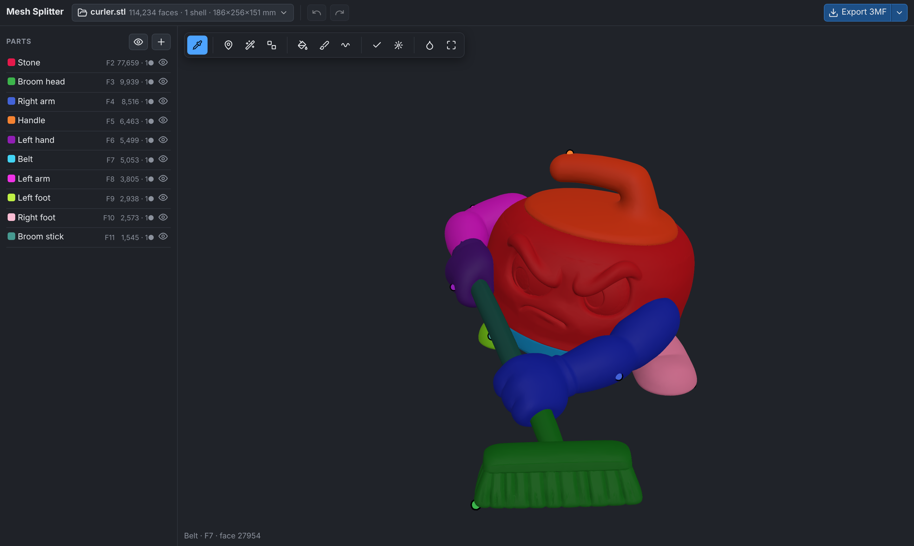

# Mesh Splitter

Turn one solid mesh into separate, colour-coded parts for multi-colour or multi-piece 3D printing. Made for AI-generated figures and other STL/3MF files that come as a single shell with no CAD source. Use it as an OrcaSlicer 2.5 plugin or in any browser.

- **Split in a few clicks:** auto split, split by shells, or drop a seed per part and let it follow the model's creases. Fill, brush and merge to fix the edges.
- **See every part at a glance:** each part gets its own colour and filament slot, with show-only, hide and inline rename.
- **Move parts in the view:** move, rotate and scale handles (W/E/R, Shift to snap), with undo.
- **Replace with…:** right-click a part and swap in another STL/3MF. It lines up on the joint and keeps the part's name and filament.
- **Send to Orca:** export one multi-part 3MF with each part on its filament, then import it with Ctrl+I. Painted 3MF, merged STL and per-part STLs are also available.
- **Optional AI review** suggests part names and flags bad cuts.

## Install

- **OrcaSlicer plugin:** download `mesh_splitter.py` from the [orca-plugin release](https://github.com/d-carrigg/mesh-splitter/releases/tag/orca-plugin). In OrcaSlicer, open **Plugins**, click the arrow next to **Browse plugins**, then **Install local plugin**. Pick the file, tick **Activate**, and allow writing to Downloads.
- **Standalone (browser):** install [uv](https://docs.astral.sh/uv/getting-started/installation/), then `uv run mesh-splitter` and it opens in your browser at `http://127.0.0.1:8766/app/`. No install step: the page is plain HTML (`app/index.html`), the small Python server only adds the optional AI review.

## Using it

Everything runs in the browser; nothing is uploaded.

- **Seed** (default tool): **+ Part**, click the model to drop a seed, repeat for each part (several seeds per part are fine), then **Segment from seeds**. Faces go to the seed reachable across the gentlest concave creases. Fix leaks with an extra seed and re-run.
- **Auto split** N parts, **Split by shells**, **Fill** (flood until a crease), **Brush** (Shift = erase), **Pick**, merge, hide/solo, undo.
- **Painted 3MF**: same mesh, each triangle painted with the part's filament slot (F#), Bambu/Orca `paint_color`. A Bambu 3MF keeps its settings and transforms.
- **Part STLs (.zip)**: one closed STL per part, cut openings fan-capped.
- **Transform** (active part): drag the handles in the view: **W** move arrows/planes, **E** rotate rings, **R** scale (centre box = all axes; an arrow scales one axis, or all three when *uniform* is ticked), **Q** hides them. Hold **Shift** to snap (1 mm, 15°, 5%). Each drag is one undo step. The same values are in the number fields: scale % (uniform or per axis; negative = mirror), rotate °, move mm about the part's centre. Shown live and applied to **Part STLs**; the painted 3MF stays one untransformed mesh. Undoable, saved in the session.
- **Replace…** (active part, or right-click a part in the view or the parts list → **Replace with…**): swap the part for another STL/3MF. It keeps the part's name and filament slot. It lines up on the old part's joint (its largest cut): the new part's thinner long-axis end goes into the cut, long axes match, **fit** scales its longest dimension to the old part's, **embed** sinks it into the rest (default 1 mm) so the slicer fuses them. **Flip** uses the other end, **Roll 90°** spins it, **Pick joint** then click the spot on the new part that should attach. Transform fine-tunes it (pivot = joint). Saved in the session.
- **Merged STL** / **Painted 3MF** with moved or replaced parts: unchanged parts keep their faces, the holes left behind are capped, and each moved/replaced part is its own closed shell overlapping the rest (slicer unions them; painted 3MF is rebuilt, so original 3MF settings aren't carried over).
- **AI review**: **Check** runs local checks (stray fragments, slivers, Unassigned faces). **Review** also renders 6 labelled views + a per-part sheet and sends them with part stats to a vision model on OpenRouter, which suggests part names (tick + **Apply names**) and flags segmentation problems (click one to solo those parts). **views / part sheet** links show exactly what was sent. Key: env `OPENROUTER_API_KEY`, a `.env` in the repo root (`OPENROUTER_API_KEY=sk-or-...`), or `server/openrouter.local.json` `{"api_key": "...", "model": "..."}` (gitignored). The key stays in the local server. Model is editable in the page (default `deepseek/deepseek-v4.1-flash`).
- Sliders: Crease step (lower = more sensitive), Smoothing (higher = ignores small dents).
- **Multi-part 3MF**: one object whose parts are the split parts (closed, transforms applied), each with its filament slot. OrcaSlicer / Bambu Studio open it as one object with parts.

## In OrcaSlicer (plugin)

`plugin/` packages the splitter as an OrcaSlicer 2.5 plugin (stock build). The **OrcaSlicer plugin** GitHub Actions workflow builds it in the cloud. Get `mesh_splitter.py` from the [orca-plugin release](https://github.com/d-carrigg/mesh-splitter/releases/tag/orca-plugin) (main) or the run's artifact (PRs). In OrcaSlicer, open **Plugins**, click the arrow next to **Browse plugins**, then **Install local plugin**. Pick the file, tick **Activate**, and allow writing to Downloads.

- The file menu (top left, shows the open model) has **Open file**, **Recent**, **Save/Load session** and, in Orca, **From the plate**. **Export 3MF** / **Send to Orca** (top right) is the multi-part 3MF; its arrow has the other formats.
- A **Mesh Splitter** tab appears next to Prepare/Preview. The file menu lists the plate's objects (refreshed when the plate changes); a single object opens automatically. The filament colour view (C) uses Orca's filament colours. The plugin can also open in its own window: **Run** on *Open Mesh Splitter window* in the Plugins dialog.
- **Send to Orca** writes `<name>_parts.3mf` (Multi-part 3MF) to Downloads (never overwriting: `name (2).3mf`) and shows an Orca notification. Import it with **Ctrl+I**. OrcaSlicer 2.5's plugin API can read the plate but cannot add or replace objects, so this import step is manual.
- Export menu items save to Downloads too. AI review needs the standalone splitter; **Check** works in both.
- Build locally: `cd plugin && npm ci && uv run python build.py` writes `dist/mesh_splitter.py`. esbuild bundles three / three-mesh-bvh / fflate into the page, with the same versions as the importmap. OrcaSlicer pages must be self-contained and under about 2 MB. Tests: `uv run python test_plugin.py`; `node e2e.mjs MESH.stl OUTDIR` drives the built page against the real plugin bridge with a fake host, and `verify_3mf.py` checks the result the way OrcaSlicer's importer reads it.

## License

MIT, see [LICENSE](LICENSE).
