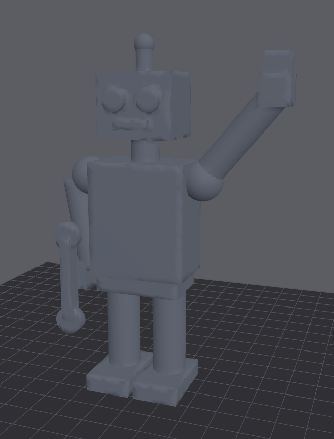
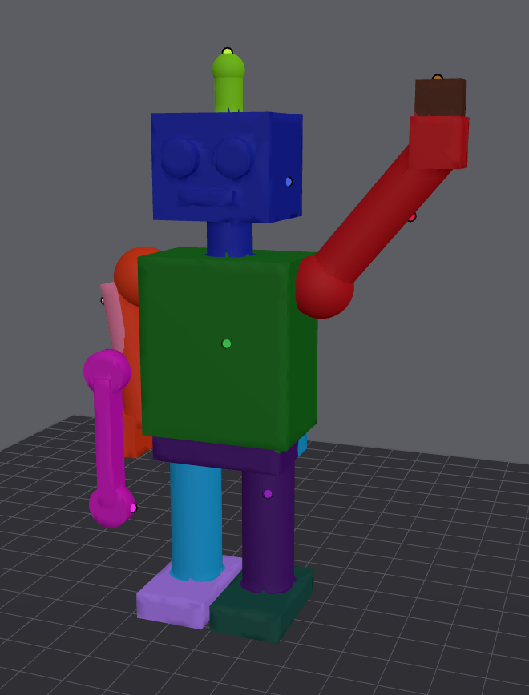
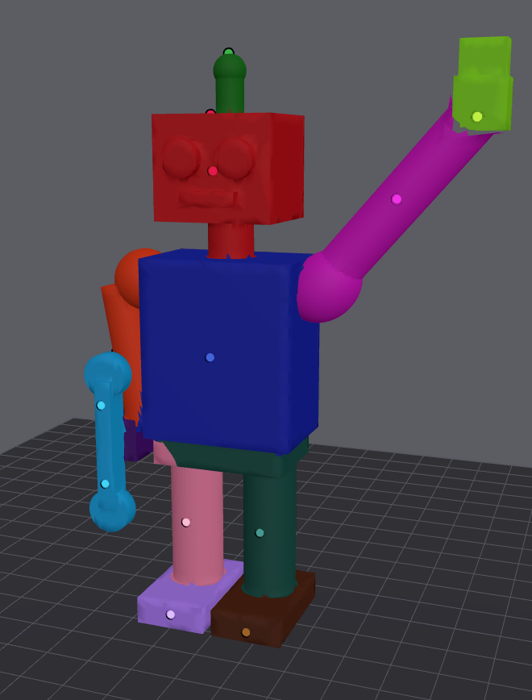
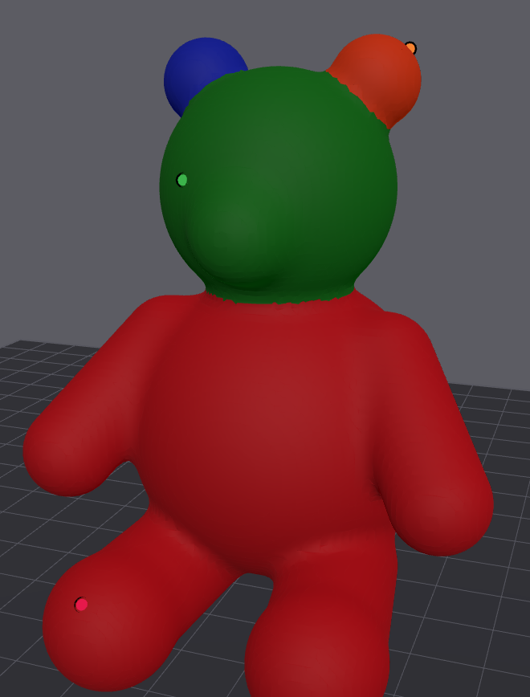
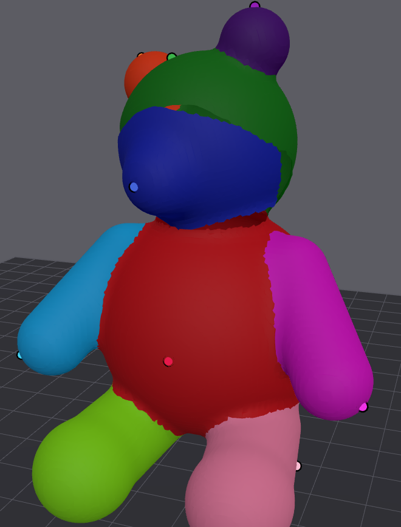
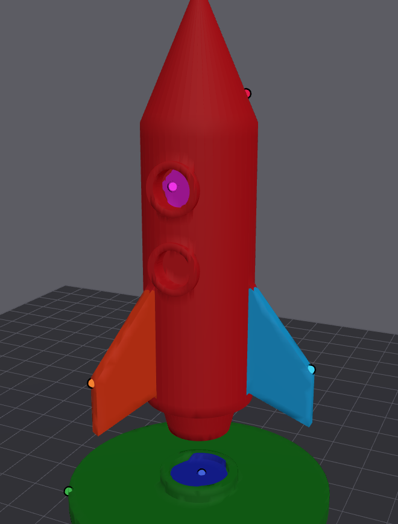

# Examples

Three test models in different styles, each split with Mesh Splitter. The models, seed files, sessions and exported 3MFs are in the repo's [examples folder](https://github.com/d-carrigg/mesh-splitter/tree/main/examples). They are made from code for this repo and share its MIT license.

To open one: open the STL, then **Open > Load session…** and pick its `.split.json`.

- [Robot](#robot)
- [Teddy bear](#teddy-bear)
- [Rocket](#rocket)

## Robot

A waving robot holding a wrench. Hard-surface style: boxes and cylinders joined with sharp concave creases. 31,496 faces, one shell, 82 × 27 × 125 mm.

| Model | Auto split on open | Final split |
| --- | --- | --- |
|  |  |  |

- **Auto split:** 12 parts. Most joints separate; the neck stays with the head, and the raised hand splits into palm and fingers.
- **Final split:** 12 parts from [seed points](features/splitting.md#seeds-and-add-part) (`robot.seeds.json`): head, antenna, torso, arms, hands, wrench, legs and feet.
- **Edits:** each hand [moves with](features/editing-parts.md) its arm and the wrench with the left hand. The right arm is [stretched](features/transforms.md#stretch) to 125%, and the hand rides out with it.
- **Files:** `robot.stl`, `robot.seeds.json`, `robot.split.json`, `robot_parts.3mf`.

```
uv run mesh-splitter split examples/robot/robot.stl --seeds examples/robot/robot.seeds.json -o robot_parts.3mf
```

## Teddy bear

A seated teddy bear. Organic style: smoothly blended blobs with soft creases, the hard case for crease detection. 61,688 faces, one shell, 65 × 58 × 82 mm.

| Model | Auto split on open | Final split |
| --- | --- | --- |
|  |  |  |

- **Auto split:** 4 parts (body with arms and legs, head, two ears). The soft blends at the arms and legs don't count as creases.
- **Final split:** 9 parts from seed points (`bear.seeds.json`): body, head, snout, ears, arms and legs.
- **Edits:** the snout and ears move with the head. The head is turned 25° with [rotate on joint](features/transforms.md#rotate-on-joint), with [heal joint](features/transforms.md#heal-joint) on.
- **Files:** `bear.stl`, `bear.seeds.json`, `bear.split.json`, `bear_parts.3mf`.

```
uv run mesh-splitter split examples/bear/bear.stl --seeds examples/bear/bear.seeds.json -o bear_parts.3mf
```

## Rocket

A rocket with three fins and two recessed portholes, on a separate launch stand. Two shells, thin fins. 20,778 faces, 60 × 60 × 113 mm.

| Model | Auto split on open | Final split |
| --- | --- | --- |
|  |  |  |

- **Auto split:** 7 parts: body, stand, the stand's socket, three fins and one porthole. The nose cone stays with the body, since it meets it at a convex edge, not a concave crease.
- **Final split:** the auto split with the parts renamed.
- **Files:** `rocket.stl`, `rocket.split.json`, `rocket_parts.3mf`.

```
uv run mesh-splitter split examples/rocket/rocket.stl -o rocket_parts.3mf
uv run mesh-splitter split examples/rocket/rocket.stl --shells -o rocket_shells.3mf
```

## Tips from these models

- **CAD-style meshes:** long, thin triangles (a box face made of two triangles) hide the creases from the splitter, and seeds grow into the wrong parts. Refine the mesh to short edges first; the robot and rocket here are refined to 2.5 mm.
- **Soft blends:** organic models with smooth joins (the bear) need seeds; auto split finds few parts on them.
- **Stretch** pivots on the part's main joint. Set the parts that hang off it (a hand on an arm) to move with it first, so it pivots at the shoulder, not the wrist.
