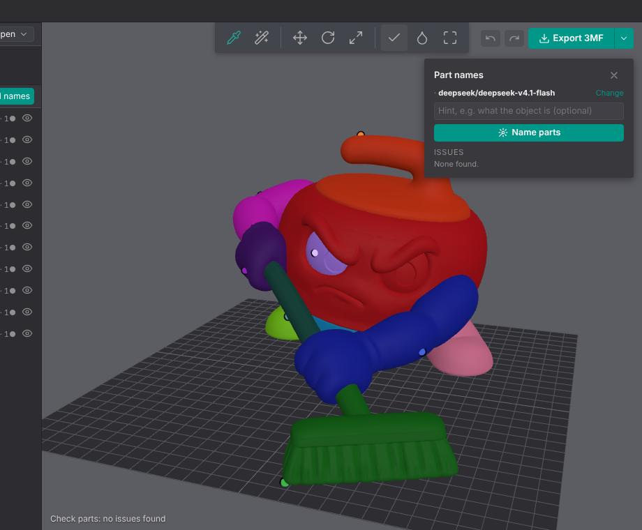
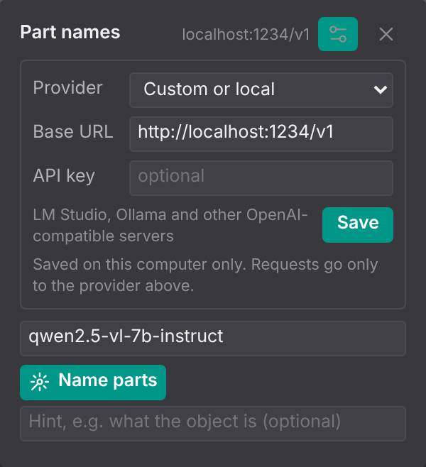

# AI part naming

!!! info "Privacy: opt-in only, sent only to the provider you choose"

    - **Opt-in only.** Nothing is sent until you pick a provider and click **Name parts**. Splitting, **Check** and everything else run on your machine.
    - **Sent only to the provider you choose.** Requests go straight from your computer (the OrcaSlicer plugin or your local server) to that provider: OpenAI, OpenRouter, Anthropic, or the base URL you enter. Their data policies apply. OpenRouter passes requests on to the model you pick.
    - **Fully local option.** With a local server such as LM Studio or Ollama, nothing leaves your computer.
    - **Not shared with anyone else.** Your models and info are never sent to the Mesh Splitter developer, OrcaSlicer or any other provider. There is no telemetry.
    - **What is sent:** rendered pictures of the split model, each part's stats and your optional hint. The mesh file itself is not sent. Saving settings also asks the provider for its list of models (no model data).
    - **Your key stays on your computer**, in a settings file only Mesh Splitter reads. It is never shown to the page.

Optional. Sends pictures of the split model and each part's stats to a vision model, which suggests a name for every part and points out bad cuts, such as stray fragments, slivers or a feature split in two. Nothing changes until you click **Apply names**.

Works in the browser version and inside the OrcaSlicer plugin.

## Providers

| Provider | Key | Base URL | Default model |
| --- | --- | --- | --- |
| OpenRouter | yes | `https://openrouter.ai/api/v1` | `deepseek/deepseek-v4.1-flash` |
| OpenAI | yes | `https://api.openai.com/v1` | `gpt-5-mini` |
| Anthropic Claude | yes | `https://api.anthropic.com/v1` | `claude-opus-5-5` |
| Custom or local | optional | any OpenAI-compatible URL | the loaded model |

The model must accept images. Type any model id the provider offers; after you save, the model box also lists the provider's models.

## Setup

1. Click **AI names** in the Parts header to open the panel.
2. Click the settings button (sliders) next to the close button.
3. Pick a provider, paste your API key, then click **Save**.

The key is saved on this computer:

- **OrcaSlicer plugin:** in the plugin's own data folder (`ai_naming.json`).
- **Browser version:** in `server/llm.local.json` (gitignored).

**Forget key** deletes the saved key for that provider.

In the browser version you can also set the key in the environment or in a `.env` file in the repo root, which wins over the saved key: `OPENROUTER_API_KEY`, `OPENAI_API_KEY`, `ANTHROPIC_API_KEY`, or `MESH_SPLITTER_LLM_KEY` for a custom server.

### OrcaSlicer permission prompt

The first time you click **Name parts** in OrcaSlicer, it asks whether Mesh Splitter may connect to the provider's address. Click **Yes**. OrcaSlicer remembers the answer for that address. If you click **No**, nothing is sent.

## Local models (LM Studio, Ollama)

Any server with an OpenAI-compatible `/v1/chat/completions` endpoint works, with no key.

1. Load a vision model (one that takes images) and start the server:
    - **LM Studio:** Developer tab, start the server. Default URL `http://localhost:1234/v1`.
    - **Ollama:** runs on `http://localhost:11434/v1`.
2. In the AI settings, pick **Custom or local** and enter the base URL, then click **Save**.
3. Pick the model from the model box, or leave it blank to use the loaded model.

Local models can be slow on a large request. Mesh Splitter waits up to 5 minutes.

## How to use it

1. Open and split a model.
2. Click **AI names** in the Parts header to open the panel.
3. Optionally change the model, and type a hint about what the object is.
4. Click **Name parts**, read the suggested names and issues, then click **Apply names** to keep the names.

## Check (no AI)

The check button next to it runs the same cut checks locally (fragments, slivers, unassigned faces) without sending anything. It works in the browser and in the plugin.
