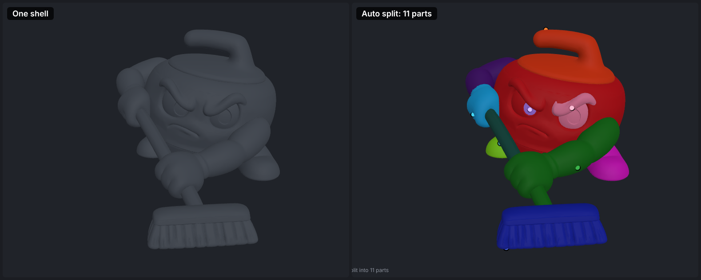
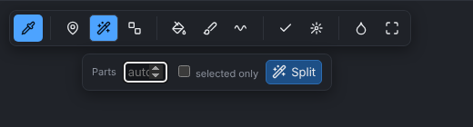

# Auto split

Splits the whole mesh into parts in one click. Cuts land on concave creases (the valleys where an arm meets a body, a handle meets a stone), so each part is a smooth piece of surface.

## How to use it

1. Open an STL or 3MF. A single-shell mesh is auto split as soon as it opens.
2. To split again, click **Auto split** in the toolbar.
3. Set **Parts**, or leave it empty to pick the count automatically. Tick **selected only** to split just the selected part.
4. Click **Split**.

## Tips

- With the automatic count, it over-splits first, then merges neighbors whose shared edge isn't a real crease.
- Each part gets its own color and filament slot (F2, F3, …). Change either on the part card.
- To refine the result, use [seeds](seeds.md), [fill, brush or merge](fill-brush-merge.md). Every step can be undone with Ctrl+Z.
