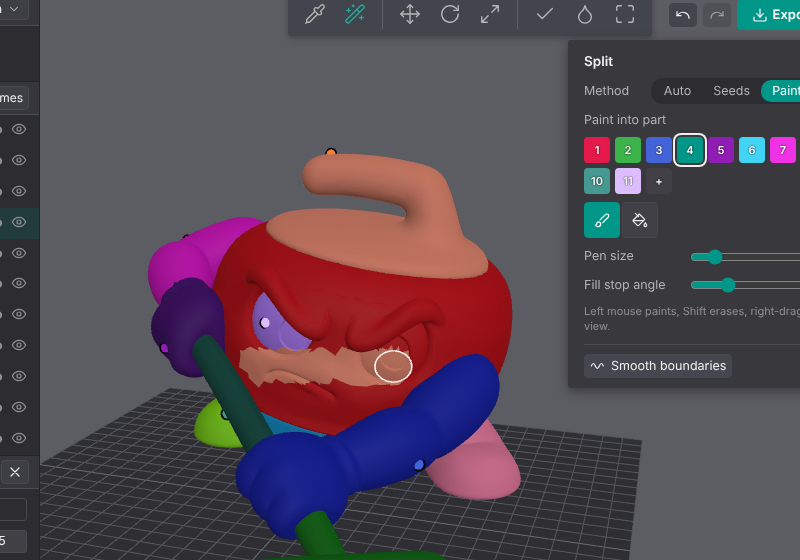
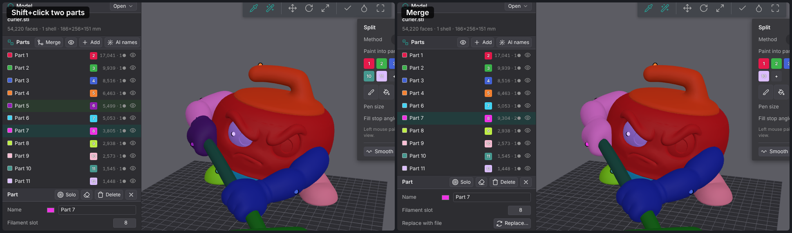
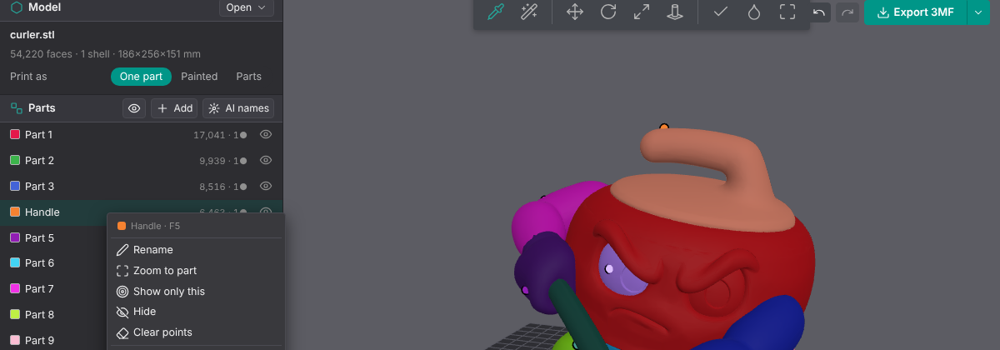

# Editing parts

Fix, swap, view and name parts after a split. Every edit can be undone with Ctrl+Z.

- [Fill](#fill)
- [Brush](#brush)
- [Merge](#merge)
- [Replace with…](#replace-with)
- [Show only this part](#show-only-this-part)
- [Rename](#rename)
- [AI part naming](#ai-part-naming)

## Fill

Floods the clicked region into the selected part, stopping at creases sharper than **Fill stop**.

1. Select the part that should grow (click it with the select tool, **V**).
2. Press **F**, then click the region to add.

Right-click also offers **Fill area into …** and **Fill all unassigned**.

## Brush

Paints faces into the selected part.

1. Select the part, then press **B**.
2. Set **Radius** (mm) and drag over the model. Hold **Shift** to erase. Right-drag still rotates the view.

## Merge

Joins parts into one.

1. Click the part to keep (its name, color and filament stay).
2. **Shift+click** the others, in the view or in the parts list.
3. Click **Merge** above the parts list (or right-click > **Merge … selected**).

To remove a part instead, select it and press **Del**: its faces join the neighboring part.

## Replace with…

Swaps a part for another STL or 3MF. The replacement keeps the part's name and filament slot.

### How to use it

1. Right-click the part > **Replace with…** (or select it and click **Replace…** on the part card).
2. Pick the file.

### Where it goes

- **In place:** if the replacement was made from this same model (for example, the same eyes edited in another program), it has the same position and size as the old part. Mesh Splitter detects that and leaves it where it is, with **in place** ticked.
- **On the joint:** otherwise it is lined up on the old part's cut: one end of its long axis sits on the joint and its long axis follows the old part's. **fit** scales it to the old part's length, and **embed** sinks it into the rest by a few mm so the slicer fuses them.

### Adjusting it

- **Flip:** attach by the other end.
- **Roll 90°:** turn it about the joint axis.
- **Pick joint:** click the spot on the replacement that should attach. Click again to go back to auto.
- **in place:** switch between in place and on the joint.
- The move / rotate / scale handles work on the replacement too.
- The trash button next to **Replace…** removes the replacement and brings the old part back.

## Show only this part

Hides every part except one, so you can check its shape and cut.

### How to use it

- Right-click the part in the view or in the parts list > **Show only this**, or select it and click the **Show only this part** button on the part card.
- Do the same again (**Show all again**) to bring the other parts back as they were.
- The eye button at the top of the parts list shows all parts. The eye on each row hides or shows one part.

### Tips

- With several parts selected (Shift+click), right-click a selected row > **Show only these**.
- Hidden parts are still exported. Hiding only changes the view.

## Rename

Parts start as `Part 1`, `Part 2`, … (or `Shell 1`, … after a shell split). Real names make the parts easy to find in OrcaSlicer, because each part keeps its name in the exported 3MF.

### How to use it

- Select the part and type in the name field at the top of the part card, then press **Enter**.
- Or double-click the name in the parts list, or right-click the row > **Rename**. **Enter** saves and **Esc** cancels.

[AI part naming](#ai-part-naming) can suggest names for all parts at once.

## AI part naming

Optional. Sends pictures of the split model and each part's stats to a vision model, which suggests a name for every part and points out bad cuts, such as stray fragments, slivers or a feature split in two. Nothing changes until you click **Apply names**.

**Browser version only.** It needs the local server (`uv run mesh-splitter`), so it isn't available inside the OrcaSlicer plugin. **OpenRouter only:** it uses the [OpenRouter](https://openrouter.ai/) API, with any model it lists that takes images.

### Setup

1. Get an API key from OpenRouter.
2. Put `OPENROUTER_API_KEY=sk-or-...` in a `.env` file in the repo root. Optionally add `OPENROUTER_MODEL=...`.
3. Run `uv run mesh-splitter`. The panel shows `key: env` when the key is found.

The key stays in the local server and is never sent to the page.

### How to use it

1. Open and split a model.
2. Click the sparkle button in the toolbar to open the panel.
3. Optionally change the model, and type a hint about what the object is.
4. Click **Name parts**, read the suggested names and issues, then click **Apply names** to keep the names.

### Check (no AI)

The check button next to it runs the same cut checks locally (fragments, slivers, unassigned faces) without sending anything. It works in the browser and in the plugin.
