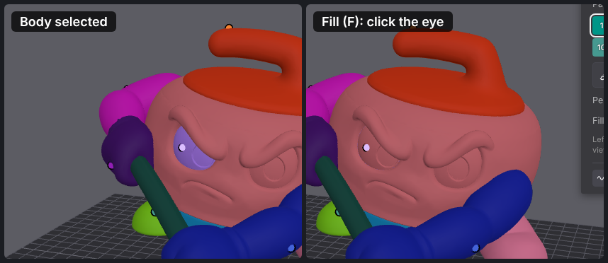
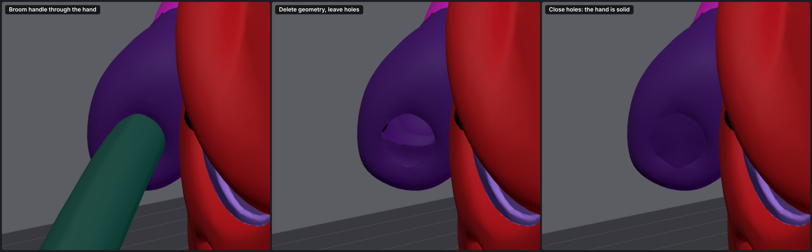
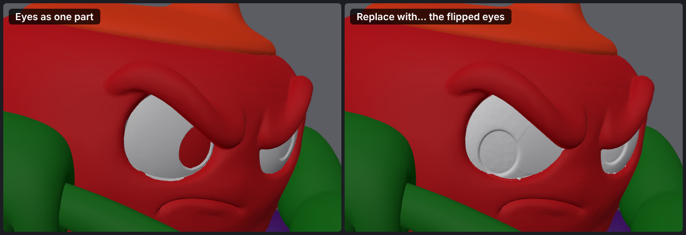
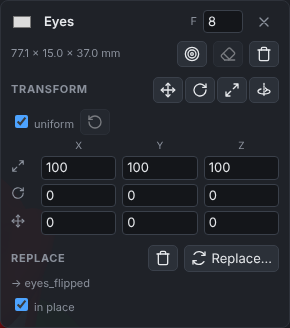
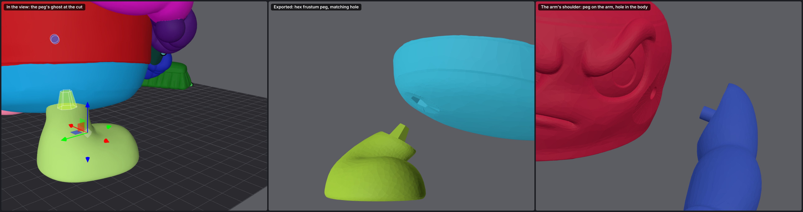
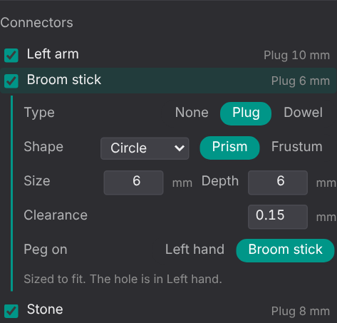
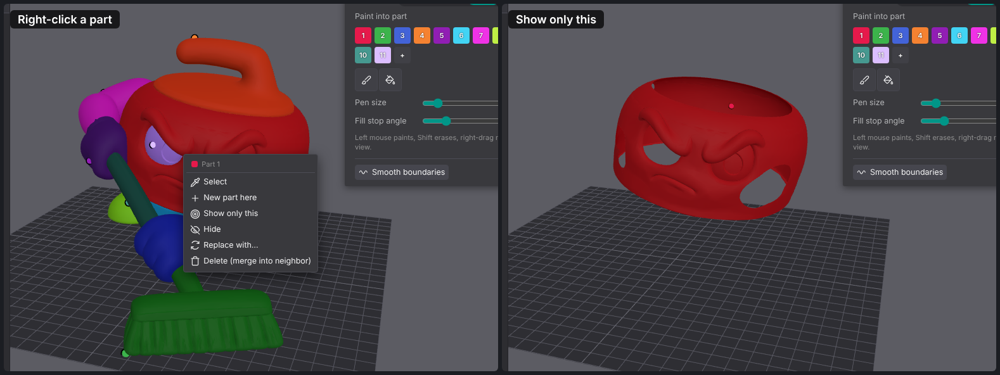
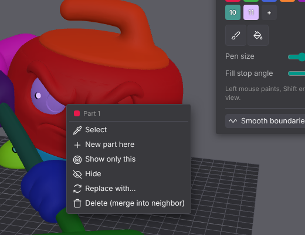

# Editing parts

Fix, swap, view and name parts after a split. Every edit can be undone with Ctrl+Z.

- [Fill](#fill)
- [Brush](#brush)
- [Merge](#merge)
- [Delete geometry](#delete-geometry)
- [Replace with…](#replace-with)
- [Connectors](#connectors)
- [Show only this part](#show-only-this-part)
- [Rename](#rename)

## Fill

Floods the clicked region into the selected part, stopping at creases sharper than **Fill stop angle**.

1. Select the part that should grow (click it with the select tool, **V**).
2. Press **F** (or pick **Paint** in the Split panel, then the fill tool), then click the region to add.

Right-click also offers **Fill area into …** and **Fill all unassigned**.

## Brush

Paints faces into the selected part.

1. Select the part, then press **B** (or pick **Paint** in the Split panel). The panel's numbered swatches pick which part you paint into.
2. Set **Pen size** (mm) and drag over the model. Hold **Shift** to erase. Right-drag still rotates the view.

## Merge

Joins parts into one.

1. Click the part to keep (its name, color and filament stay).
2. **Shift+click** the others, in the view or in the parts list.
3. Click **Merge** above the parts list (or right-click > **Merge … selected**).

To remove a part instead, select it and press **Del**: its faces join the neighboring part.

## Delete geometry

Removes a part's faces from the model itself (**Del** keeps them and hands them to a neighbor). Use it to drop a piece you don't want to print, such as a broom handle you will print separately.

- Right-click the part > **Delete geometry, close holes**, select it and click **Remove** in the sidebar's **Part** section, or press **Shift+Del**. Each hole it leaves in a neighboring part is closed with a patch that follows that part's surface, in that part's color.
- **Delete geometry, leave holes** keeps the holes open. Right-click a part with holes > **Close holes in this part** to close them later.
- Undo (Ctrl+Z) brings the part back.

## Replace with…

Swaps a part for another STL or 3MF. The replacement keeps the part's name and filament slot.

### How to use it

1. Right-click the part > **Replace with…** (or select it and click **Replace…** in the sidebar's **Part** section).
2. Pick the file.

### Where it goes

- **In place:** if the replacement was made from this same model (for example, the same eyes edited in another program), it has the same position and size as the old part. Mesh Splitter detects that and leaves it where it is, with **in place** ticked.
- **On the joint:** otherwise it is lined up on the old part's cut: one end of its long axis sits on the joint and its long axis follows the old part's. **fit** scales it to the old part's length, and **embed** sinks it into the rest by a few mm so the slicer fuses them.

### Adjusting it

- **Flip:** attach by the other end.
- **Roll 90°:** turn it about the joint axis.
- **Pick joint:** click the spot on the replacement that should attach. Click again to go back to auto.
- **in place:** switch between in place and on the joint.
- The move / rotate / scale handles work on the replacement too.
- The trash button next to **Replace…** removes the replacement and brings the old part back.

## Connectors

Adds a peg and a matching hole where two parts meet, like the connectors in OrcaSlicer's Cut tool, so parts you print separately line up and glue together.

Connectors are placed for you: each sits at the center of the part's cut, points straight through it, and starts at the largest size that fits. You only pick which parts get one, and change any setting you like.

### How to use it

- **Every part at once:** click **All parts** under **Connector** (or right-click a part > **Connectors on all parts**). Each part's main cut that doesn't have a connector yet gets a plug, one per cut, where one fits. Then select any part to change its connector or set it to **None**. **Remove all** takes them all off.
- **Several parts:** Ctrl+click or Shift+click parts in the list. A connector change then applies to all the selected parts.
- **One part:**

1. Select the part. The connector goes on its main cut: the one toward the bigger part it joins, such as a foot's cut to the base.
2. Under **Connector**, pick **Plug** or **Dowel**.
   - **Plug:** a peg on one part and a hole in the other. **Peg on** picks which part gets the peg.
   - **Dowel:** a hole in both parts, plus a separate peg that exports as its own part (named "*part* dowel").
3. Adjust it if you need to. It starts at the largest size that fits the cut.

| Setting | What it does |
| --- | --- |
| **Shape** | Circle, square, hexagon or triangle cross-section. Square, hexagon and triangle pegs can't turn in their holes. |
| **Prism / Frustum** | Straight sides, or tapered to 60% at the tip, which eases fitting and avoids a flat overhang at the tip. |
| **Size** | Width across flats (a circle's diameter), in mm. |
| **Depth** | How far the peg goes into the other part, in mm. A dowel goes this far into each part. |
| **Clearance** | Gap added to the hole on every side, in mm (the hole is also 0.2 mm plus the clearance deeper than the peg). 0.1 to 0.2 mm suits most PLA and PETG prints. |

### Where it goes

- The connector is built into **Part STLs** and the **multi-part 3MF** (Print as **Parts**, including Send to Orca). In OrcaSlicer, right-click the object > **Split** > **To objects** to print the parts apart.
- One part, Painted and the Merged STL print the model as one piece, so they have no connectors.
- In the view, the peg shows as a see-through ghost at the cut, in its part's color, with the hole's outline in white. Both turn red when it doesn't fit.
- The part card says why a connector doesn't fit: the hole breaks out of its part (it wants 0.8 mm of wall around it), or the cut doesn't go around the connector's axis. The connector is left out of the files until it fits.
- With **At the cut** set to Fill or Anchor, the parts print joined, so there's no connector.
- Undo (Ctrl+Z) works on every change. The command line doesn't add connectors yet.

## Show only this part

Hides every part except one, so you can check its shape and cut.

### How to use it

- Right-click the part in the view or in the parts list > **Show only this**, or select it and click **Solo** in the sidebar's **Part** section.
- Do the same again (**Show all again**) to bring the other parts back as they were.
- The eye button at the top of the parts list shows all parts. The eye on each row hides or shows one part.

### Tips

- With several parts selected (Shift+click), right-click a selected row > **Show only these**.
- Hidden parts are still exported. Hiding only changes the view.

## Rename

Parts start as `Part 1`, `Part 2`, … (or `Shell 1`, … after a shell split). Real names make the parts easy to find in OrcaSlicer, because each part keeps its name in the exported 3MF.

### How to use it

- Select the part and type in the **Name** field of the sidebar's **Part** section, then press **Enter**.
- Or double-click the name in the parts list, or right-click the row > **Rename**. **Enter** saves and **Esc** cancels.

[AI part naming](ai-naming.md) can suggest names for all parts at once.
