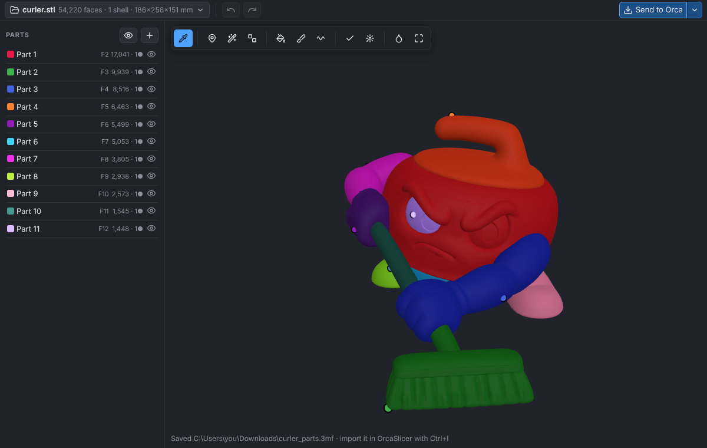
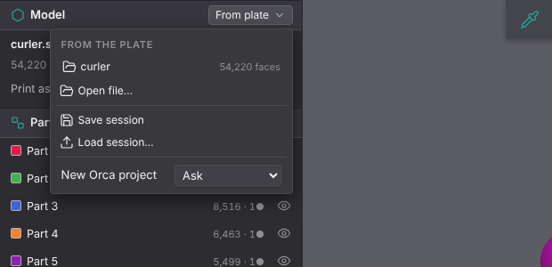

# Exporting

Get the parts out as a 3MF or STLs, from OrcaSlicer or the browser.

- [Send to Orca](#send-to-orca)
- [Other exports](#other-exports)

## Send to Orca

Inside OrcaSlicer, the main button is **Send to Orca**. It saves one multi-part 3MF: one object, with each part as a separate part on its own filament slot, and the part names kept.

### How to use it

1. Install the plugin (see [Install in OrcaSlicer](../index.md#install-in-orcaslicer)) and open the **Mesh Splitter** tab.
2. Pick the object from the plate in the file menu. A single object on the plate opens by itself.
3. Split it, then click **Send to Orca**.
4. It saves `<name>_parts.3mf` to Downloads, and the status bar shows the path. In OrcaSlicer, import it with **Ctrl+I**.

### Why a file

OrcaSlicer's plugin API can read the plate's meshes but can't add or replace objects, so the result comes back as a file to import.

## Other exports

The arrow next to the main button (in the plugin and the browser) also offers:

- **Painted 3MF:** the same mesh, each triangle painted with its part's filament.
- **Part STLs (.zip):** one closed STL per part, cut faces capped.

A part that is a recess (a porthole, an eye socket) can't be capped flat: that would make a solid of the air in it. Instead it gets a 1 mm skin of material behind its surface, and the part around it is closed over that skin, so the parts still add up to the original model. This applies to the multi-part 3MF and the part STLs while both parts are in place.
- **Merged STL:** the whole model as one STL, with moved and replaced parts where you put them.

In the browser version the main button is **Export 3MF** and downloads the same multi-part 3MF.
