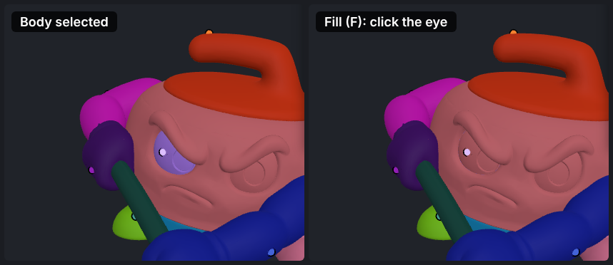
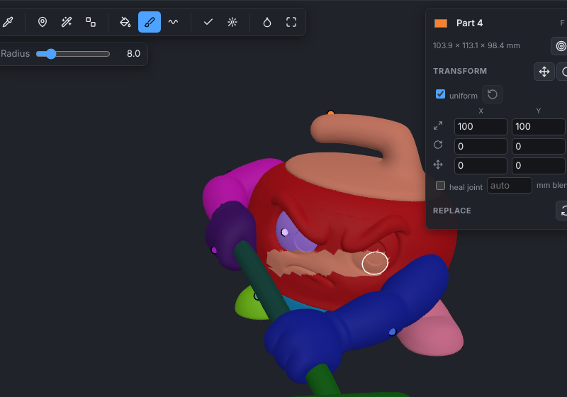
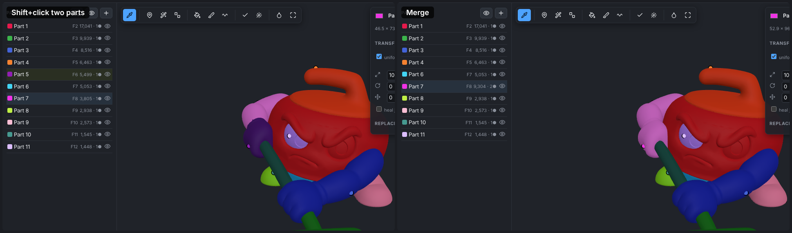

# Fill, brush and merge

Hand tools for fixing parts after a split. All of them work on the selected part and can be undone with Ctrl+Z.

## Fill

Floods the clicked region into the selected part, stopping at creases sharper than **Fill stop**.

1. Select the part that should grow (click it with the select tool, **V**).
2. Press **F**, then click the region to add.

Right-click also offers **Fill area into …** and **Fill all unassigned**.

## Brush

Paints faces into the selected part.

1. Select the part, then press **B**.
2. Set **Radius** (mm) and drag over the model. Hold **Shift** to erase. Right-drag still rotates the view.

## Merge

Joins parts into one.

1. Click the part to keep (its name, color and filament stay).
2. **Shift+click** the others, in the view or in the parts list.
3. Click **Merge** above the parts list (or right-click > **Merge … selected**).

To remove a part instead, select it and press **Del**: its faces join the neighboring part.
