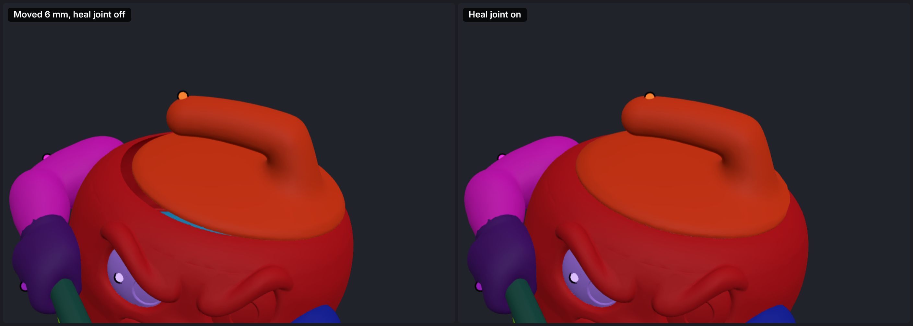

# Heal joint

After you move or rotate a part, its cut edge may no longer line up with its neighbor, which leaves a gap or a step. Heal joint stretches or squeezes the part near its cut so the cut's edge lands back on the neighbor's edge. Added in [#24](https://github.com/d-carrigg/mesh-splitter/pull/24).

## How to use it

1. Move or rotate a part (see [transforms](transforms.md)).
2. On the part card, tick **heal joint**.
3. Optionally set the **mm blend**: how far from the cut the shape may change. It starts at 20% of the cut's radius (1 to 15 mm); the rest of the part keeps its exact shape.

## Tips

- The healed shape is used by Send to Orca, the multi-part 3MF and all STL exports, and it stays a closed solid.
- It works with any move or rotate. [Rotate on joint](rotate-on-joint.md) plus heal joint is the usual pair for turning a part in place.
- Replaced parts can't be healed; the option hides for them.
- Undo turns it off like any other edit.
