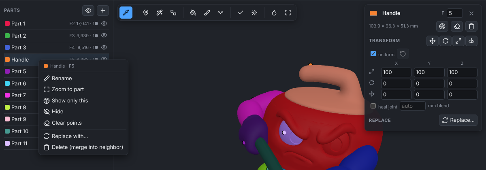

# Rename

Parts start as `Part 1`, `Part 2`, … (or `Shell 1`, … after a shell split). Real names make the parts easy to find in OrcaSlicer, because each part keeps its name in the exported 3MF.

## How to use it

- Select the part and type in the name field at the top of the part card, then press **Enter**.
- Or double-click the name in the parts list, or right-click the row > **Rename**. **Enter** saves and **Esc** cancels.

[AI part naming](ai-part-naming.md) can suggest names for all parts at once.
