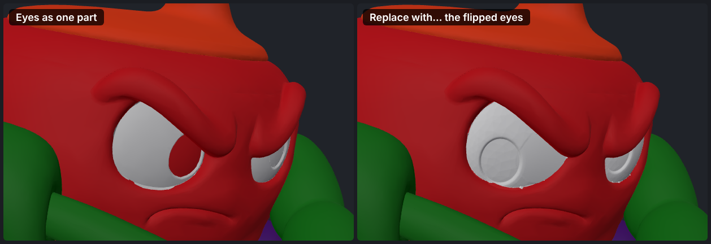
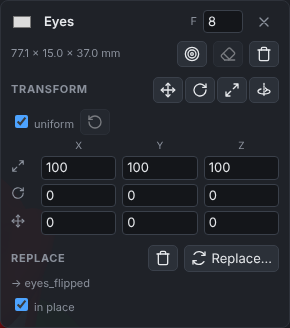

# Replace with…

Swaps a part for another STL or 3MF. The replacement keeps the part's name and filament slot.

## How to use it

1. Right-click the part > **Replace with…** (or select it and click **Replace…** on the part card).
2. Pick the file.

## Where it goes

- **In place:** if the replacement was made from this same model (for example, the same eyes edited in another program), it has the same position and size as the old part. Mesh Splitter detects that and leaves it where it is, with **in place** ticked.
- **On the joint:** otherwise it is lined up on the old part's cut: one end of its long axis sits on the joint and its long axis follows the old part's. **fit** scales it to the old part's length, and **embed** sinks it into the rest by a few mm so the slicer fuses them.

## Adjusting it

- **Flip:** attach by the other end.
- **Roll 90°:** turn it about the joint axis.
- **Pick joint:** click the spot on the replacement that should attach. Click again to go back to auto.
- **in place:** switch between in place and on the joint.
- The move / rotate / scale handles work on the replacement too.
- The trash button next to **Replace…** removes the replacement and brings the old part back.
