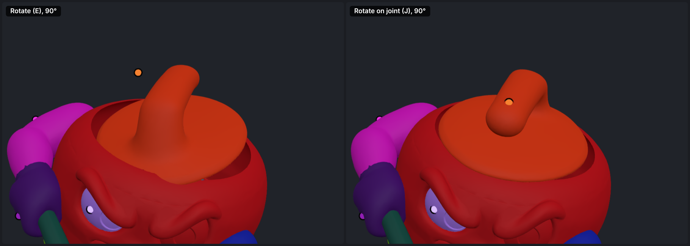
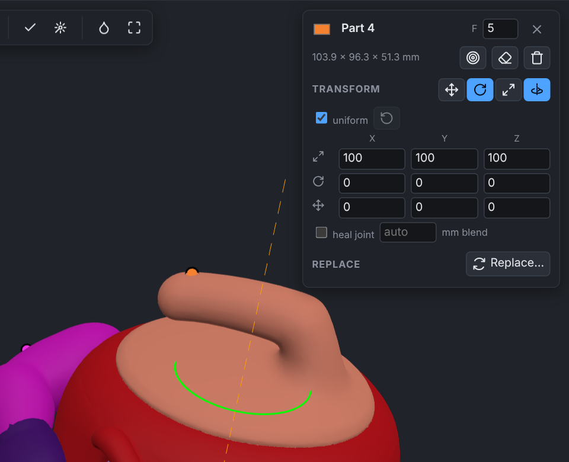
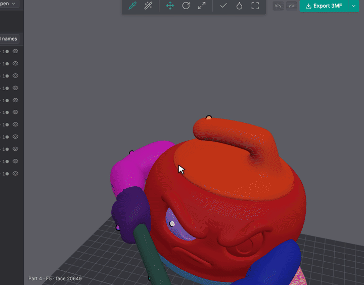

# Rotate on joint

Spins a part about its cut instead of the world axes. The axis is the cut's normal and the pivot is the cut's center, so a part on an angled surface stays seated on the part it joins. Added in [#23](https://github.com/d-carrigg/mesh-splitter/pull/23).

## How to use it

1. Select the part.
2. Press **J** (or the joint button next to the move / rotate / scale buttons on the part card). One ring appears, with a dashed line showing the joint's axis and the cut outlined in green.
3. Drag the ring. Hold **Shift** to snap to 15°.

## Tips

- A part with no cut (a separate shell) rotates on the world axes instead, and the status bar says so.
- The rotation is stored as a normal rotation plus move, so the values on the part card stay editable.
- If a rotated part still doesn't meet its neighbor exactly (an oval cut, for example), turn on [heal joint](heal-joint.md).
