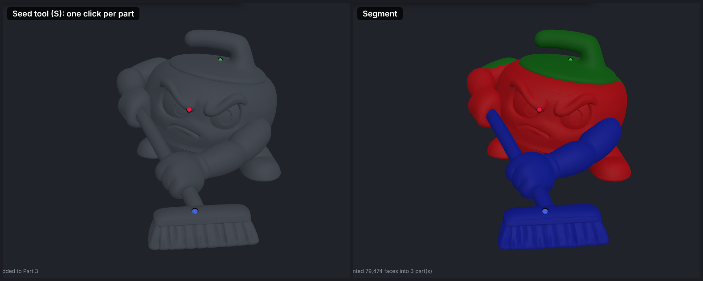
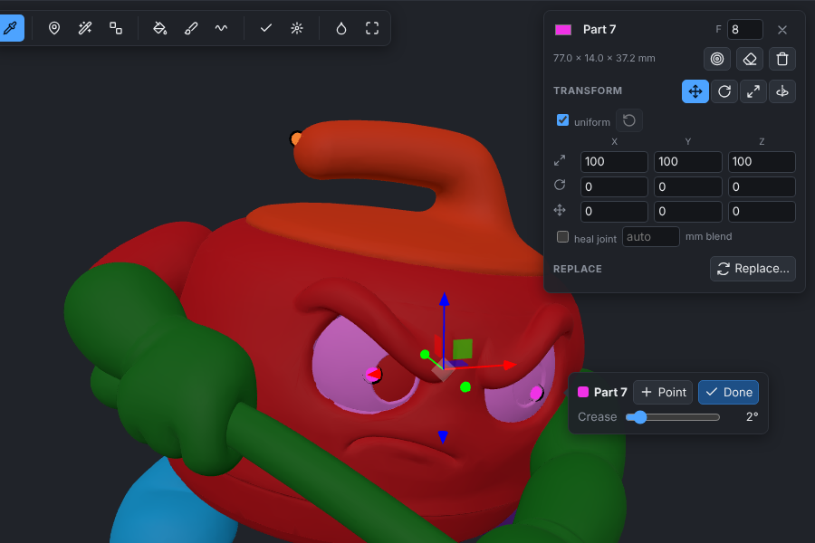

# Seeds and Add part

Pick exactly where each part is. Each seed grows across the surface until it meets a crease or another part.

## Seed tool

1. Press **S** (or click the seed tool).
2. Click the model once per part. A click with no part selected starts a new part; with a part selected, it adds another seed to that part. Press **Esc** to deselect before starting the next part. **Alt+click** removes the nearest seed.
3. Click **Segment**.

Options:

- **Crease:** how sharp a concave crease must be to separate parts. Lower splits at softer creases; 0 uses surface distance only.
- **Denoise:** smooths the crease map so small dents don't count.
- **Clear all seeds** (eraser) removes every seed.

## Add part (guided)

The **+** button above the parts list adds one part at a time:

1. Click **+**, then click the model where the new part is. It grows right away.
2. If it missed an area, click **Point** and click that area too.
3. Drag **Crease** to grow it more or less, then click **Done**.

