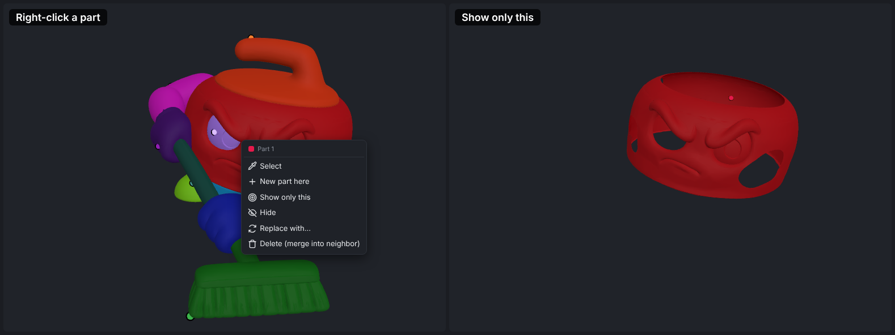
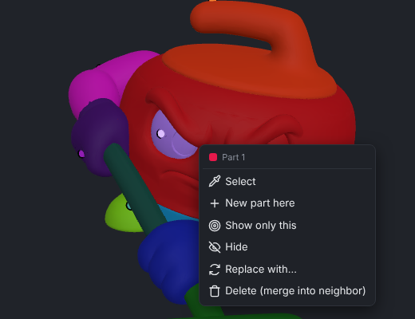

# Show only this part

Hides every part except one, so you can check its shape and cut.

## How to use it

- Right-click the part in the view or in the parts list > **Show only this**, or select it and click the **Show only this part** button on the part card.
- Do the same again (**Show all again**) to bring the other parts back as they were.
- The eye button at the top of the parts list shows all parts. The eye on each row hides or shows one part.

## Tips

- With several parts selected (Shift+click), right-click a selected row > **Show only these**.
- Hidden parts are still exported. Hiding only changes the view.

