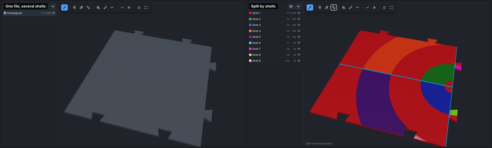

# Split by shells

Makes one part per disconnected piece (shell) of the mesh. Use it for files that already hold separate bodies, such as a multi-color tile or an assembly exported as one STL. No crease detection runs.

## How to use it

1. Open the file. The header shows how many shells it has (for example `9 shells`).
2. Click **Split by shells** in the toolbar (next to **Auto split**).
3. Each shell becomes a part named `Shell 1`, `Shell 2`, … with its own filament slot.

## Tips

- A mesh with one connected shell can't be split this way. Use [auto split](auto-split.md) or [seeds](seeds.md) instead.
- To print several shells in the same color, select them and [merge](fill-brush-merge.md#merge) them, or give them the same filament slot.
