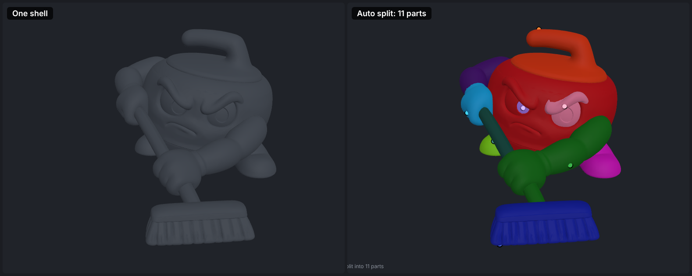
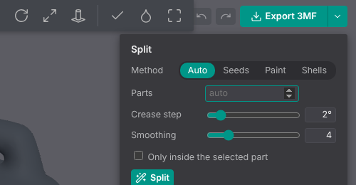
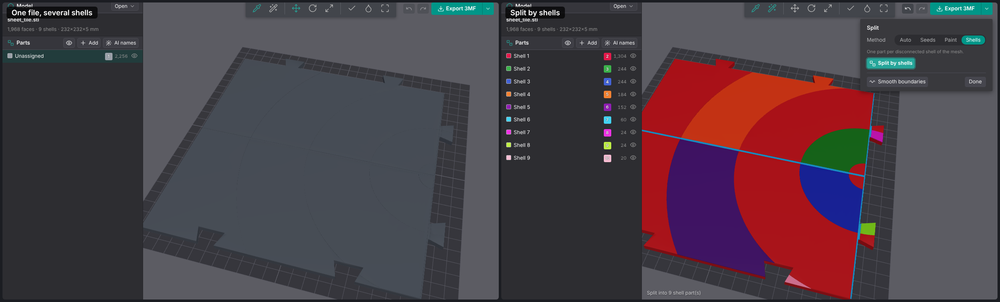
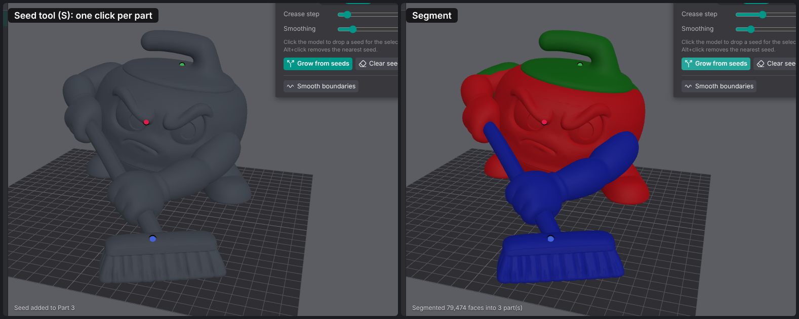
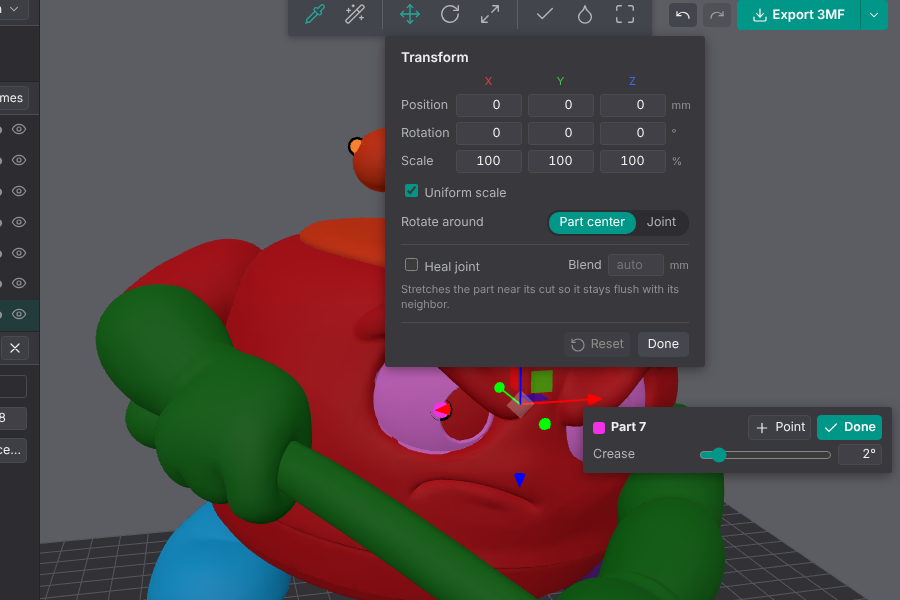

# Splitting

Three ways to turn one mesh into parts.

- [Auto split](#auto-split)
- [Split by shells](#split-by-shells)
- [Seeds and Add part](#seeds-and-add-part)

## Auto split

Splits the whole mesh into parts in one click. Cuts land on concave creases (the valleys where an arm meets a body, a handle meets a stone), so each part is a smooth piece of surface.

### How to use it

1. Open an STL or 3MF. A single-shell mesh is auto split as soon as it opens.
2. To split again, click **Auto split** in the toolbar.
3. Set **Parts**, or leave it empty to pick the count automatically. Tick **selected only** to split just the selected part.
4. Click **Split**.

### Tips

- With the automatic count, it over-splits first, then merges neighbors whose shared edge isn't a real crease.
- Each part gets its own color and filament slot (F2, F3, …). Change either on the part card.
- To refine the result, use [seeds](#seeds-and-add-part), [fill, brush or merge](editing-parts.md#fill). Every step can be undone with Ctrl+Z.

## Split by shells

Makes one part per disconnected piece (shell) of the mesh. Use it for files that already hold separate bodies, such as a multi-color tile or an assembly exported as one STL. No crease detection runs.

### How to use it

1. Open the file. The header shows how many shells it has (for example `9 shells`).
2. Click **Split by shells** in the toolbar (next to **Auto split**).
3. Each shell becomes a part named `Shell 1`, `Shell 2`, … with its own filament slot.

### Tips

- A mesh with one connected shell can't be split this way. Use [auto split](#auto-split) or [seeds](#seeds-and-add-part) instead.
- To print several shells in the same color, select them and [merge](editing-parts.md#merge) them, or give them the same filament slot.

## Seeds and Add part

Pick exactly where each part is. Each seed grows across the surface until it meets a crease or another part.

### Seed tool

1. Press **S** (or click the seed tool).
2. Click the model once per part. A click with no part selected starts a new part; with a part selected, it adds another seed to that part. Press **Esc** to deselect before starting the next part. **Alt+click** removes the nearest seed.
3. Click **Segment**.

Options:

- **Crease:** how sharp a concave crease must be to separate parts. Lower splits at softer creases; 0 uses surface distance only.
- **Denoise:** smooths the crease map so small dents don't count.
- **Clear all seeds** (eraser) removes every seed.

### Add part (guided)

The **+** button above the parts list adds one part at a time:

1. Click **+**, then click the model where the new part is. It grows right away.
2. If it missed an area, click **Point** and click that area too.
3. Drag **Crease** to grow it more or less, then click **Done**.

