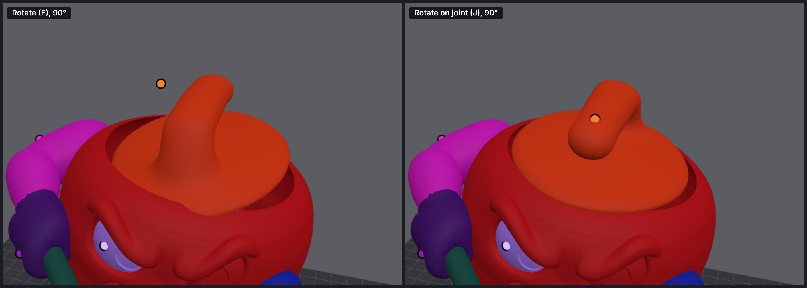
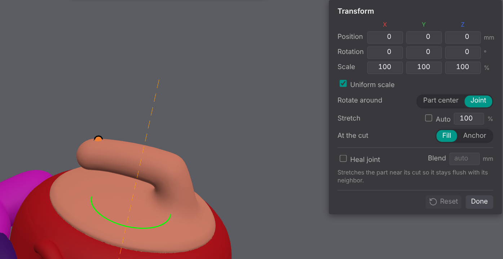
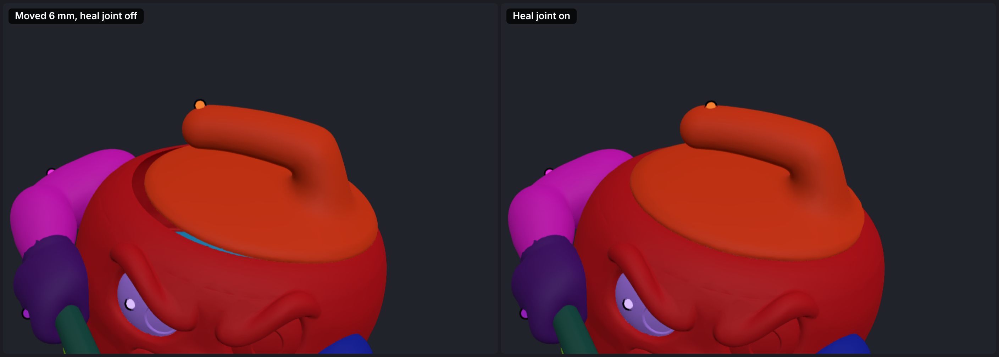
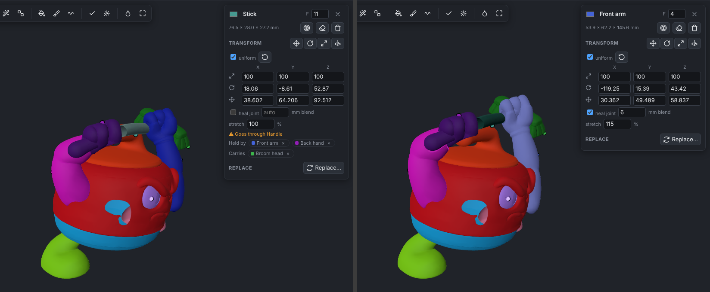

# Move, rotate, scale and heal

Change a part's position, angle and size, and keep it joined to its neighbor.

- [Move, rotate, scale and undo](#move-rotate-scale-and-undo)
- [Rotate on joint](#rotate-on-joint)
- [Heal joint](#heal-joint)
- [Stretch](#stretch)
- [Collision warning](#collision-warning)

## Move, rotate, scale and undo

Each part can be moved, rotated and scaled on its own. The change shows in the view and is used by every export.

### How to use it

1. Click a part with the select tool (**V**).
2. Press a key for handles in the view:
   - **W:** move arrows. Shift snaps to 1 mm.
   - **E:** rotate rings. Shift snaps to 15°.
   - **R:** scale handles (corner box = all axes, arrow = one axis). Shift snaps to 5%.
   - **J:** [rotate on joint](#rotate-on-joint).
   - **Q:** hide the handles.
3. Or type values on the part card: scale %, rotation ° and move mm for X / Y / Z. **uniform** scales all three axes together. The reset button clears the part's transform.

### Undo

**Ctrl+Z** undoes and **Ctrl+Y** redoes edits: transforms, splits, fills, merges and replacements. Each handle drag is one undo step. The undo and redo buttons are in the top bar.

### Tips

- The pivot is the part's center (the joint's center for rotate on joint).
- After a move or rotate, a part can leave a gap at its cut. [Heal joint](#heal-joint) closes it.

## Rotate on joint

Spins a part about its cut instead of the world axes. The axis is the cut's normal and the pivot is the cut's center, so a part on an angled surface stays seated on the part it joins. Added in [#23](https://github.com/d-carrigg/mesh-splitter/pull/23).

### How to use it

1. Select the part.
2. Press **J** (or the joint button next to the move / rotate / scale buttons on the part card). One ring appears, with a dashed line showing the joint's axis and the cut outlined in green.
3. Drag the ring. Hold **Shift** to snap to 15°.

### Tips

- A part with no cut (a separate shell) rotates on the world axes instead, and the status bar says so.
- The rotation is stored as a normal rotation plus move, so the values on the part card stay editable.
- If a rotated part still doesn't meet its neighbor exactly (an oval cut, for example), turn on [heal joint](#heal-joint).

## Heal joint

After you move or rotate a part, its cut edge may no longer line up with its neighbor, which leaves a gap or a step. Heal joint stretches or squeezes the part near its cut so the cut's edge lands back on the neighbor's edge. Added in [#24](https://github.com/d-carrigg/mesh-splitter/pull/24).

### How to use it

1. Move or rotate a part (see [transforms](#move-rotate-scale-and-undo)).
2. On the part card, tick **heal joint**.
3. Optionally set the **mm blend**: how far from the cut the shape may change. It starts at 20% of the cut's radius (1 to 15 mm); the rest of the part keeps its exact shape.

### Tips

- The healed shape is used by Send to Orca, the multi-part 3MF and all STL exports, and it stays a closed solid.
- It works with any move or rotate. [Rotate on joint](#rotate-on-joint) plus heal joint is the usual pair for turning a part in place.
- Replaced parts can't be healed; the option hides for them.
- Undo turns it off like any other edit.

## Stretch

Lengthens (over 100%) or shortens a part along its own length, from its joint with the rest. Use it to lengthen raised arms so the broom they hold clears the stone's handle.

### How to use it

1. Select the part (Ctrl+click to select more, e.g. both arms).
2. On the part card, type a **stretch %**. It applies to every selected part. 100 turns it off.

### Tips

- The joint stays put, so [heal joint](#heal-joint) keeps it seated.
- Parts that move with it move out with its end without stretching, and a part it holds re-solves onto the new grips.
- It works on top of move, rotate and rotate on joint. Reset clears it.

## Collision warning

After a transform, a part that passes through another part it didn't touch before (the broom stick through the handle) shows **⚠ Goes through …** on its part card, in the status bar and in Check. Parts that share a cut are skipped, since they always touch there.

