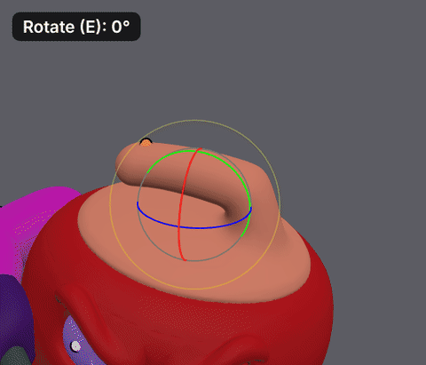
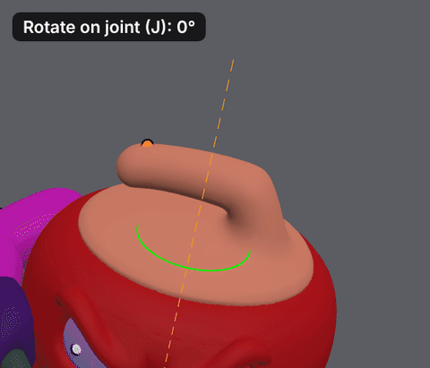
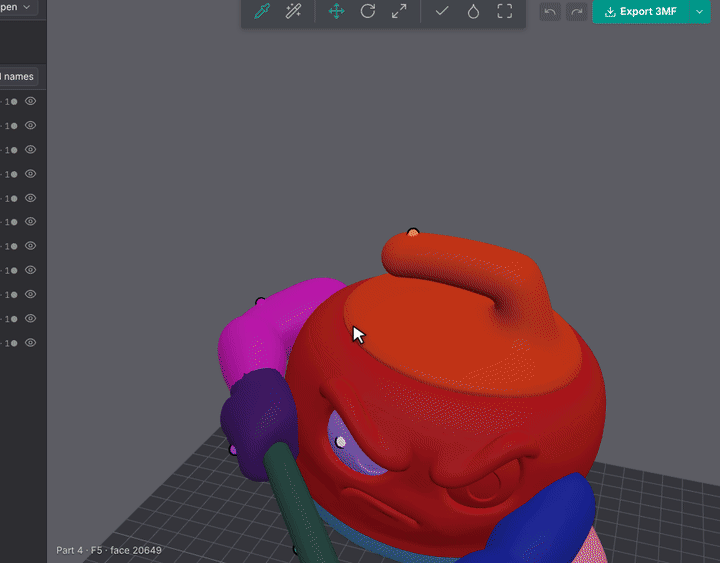
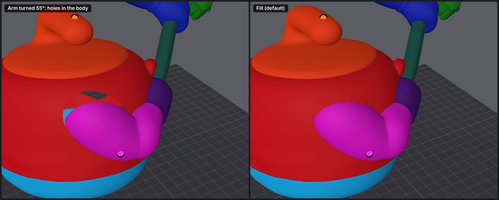
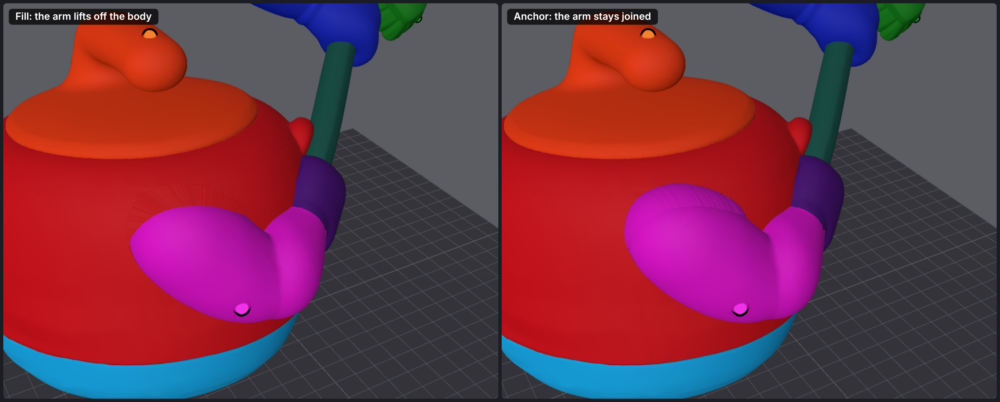
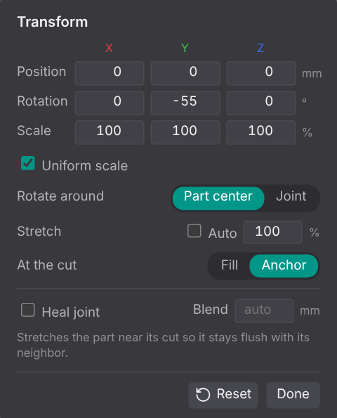
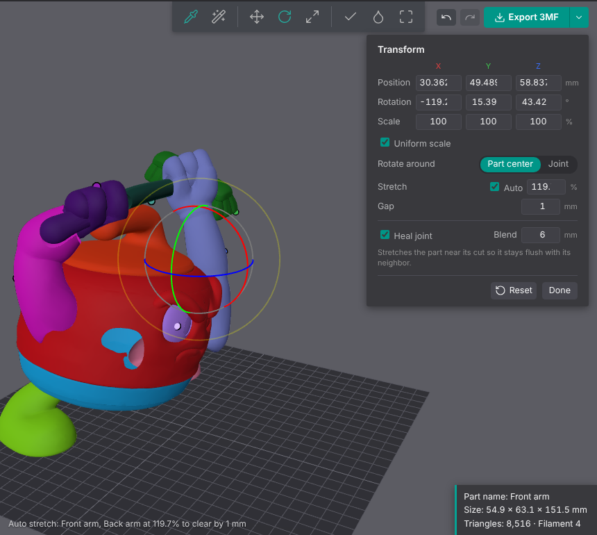

# Move, rotate, scale and heal

Change a part's position, angle and size, and keep it joined to its neighbor.

- [Move, rotate, scale and undo](#move-rotate-scale-and-undo)
- [Rotate on joint](#rotate-on-joint)
- [Heal joint](#heal-joint)
- [Fill and anchor](#fill-and-anchor)
- [Stretch](#stretch)
- [Collision warning](#collision-warning)

## Move, rotate, scale and undo

Each part can be moved, rotated and scaled on its own. The change shows in the view and is used by every export.

### How to use it

1. Click a part with the select tool (**V**).
2. Press a key for handles in the view:
   - **W:** move arrows. Shift snaps to 1 mm.
   - **E:** rotate rings. Shift snaps to 15°.
   - **R:** scale handles (corner box = all axes, arrow = one axis). Shift snaps to 5%.
   - **J:** [rotate on joint](#rotate-on-joint).
   - **Q:** hide the handles.
3. Or type values in the **Transform** panel that opens at the right of the view with the move / rotate / scale tools: position mm, rotation ° and scale % for X / Y / Z. **Uniform scale** scales all three axes together. **Reset** clears the part's transform and **Done** closes the panel.

### Undo

**Ctrl+Z** undoes and **Ctrl+Y** redoes edits: transforms, splits, fills, merges and replacements. Each handle drag is one undo step. The undo and redo buttons are at the top right of the view.

### Tips

- The pivot is the part's center (the joint's center for rotate on joint).
- After a move or rotate, a part can leave a gap at its cut. [Heal joint](#heal-joint) closes it.

## Rotate on joint

Spins a part about its cut instead of the world axes. The axis is the cut's normal and the pivot is the cut's center, so a part on an angled surface stays seated on the part it joins. Added in [#23](https://github.com/d-carrigg/mesh-splitter/pull/23).

{ width="49%" } { width="49%" }

### How to use it

1. Select the part.
2. Press **J** (or set **Rotate around** to **Joint** in the Transform panel). One ring appears, with a dashed line showing the joint's axis and the cut outlined in green.
3. Drag the ring. Hold **Shift** to snap to 15°.

### Tips

- A part with no cut (a separate shell) rotates on the world axes instead, and the status bar says so.
- A part with several cuts (an arm with a hand) turns on the cut toward the body: cuts to parts it carries, holds or reaches for are skipped, then the cut to the biggest neighbor that is bigger than the part wins (the shoulder, not the wrist).
- The rotation is stored as a normal rotation plus move, so its values stay editable in the Transform panel.
- If a rotated part still doesn't meet its neighbor exactly (an oval cut, for example), turn on [heal joint](#heal-joint).

## Heal joint

After you move or rotate a part, its cut edge may no longer line up with its neighbor, which leaves a gap or a step. Heal joint stretches or squeezes the part near its cut so the cut's edge lands back on the neighbor's edge. Added in [#24](https://github.com/d-carrigg/mesh-splitter/pull/24).

### How to use it

1. Move or rotate a part (see [transforms](#move-rotate-scale-and-undo)).
2. In the Transform panel, tick **Heal joint**.
3. Optionally set the **mm blend**: how far from the cut the shape may change. It starts at 20% of the cut's radius (1 to 15 mm); the rest of the part keeps its exact shape.

### Tips

- The healed shape is used by Send to Orca, the multi-part 3MF and all STL exports, and it stays a closed solid.
- It works with any move or rotate. [Rotate on joint](#rotate-on-joint) plus heal joint is the usual pair for turning a part in place.
- Replaced parts can't be healed; the option hides for them.
- Undo turns it off like any other edit.

## Fill and anchor

When a part moves away from the part it joined, the cut opens and both sides show a hole. Each part chooses what happens there, under **At the cut** in the Transform panel.

- **Fill** (default): the hole is patched. The bigger side (the body) gets a patch that follows its own curve, so the body stays smooth where a hand used to rest. The smaller side gets a flat face.
- **Anchor**: the part stays joined where it attaches. New material sweeps from the neighbor's rim to the part's moved cut, along the same turn, so an arm raised at the shoulder stays on the body instead of lifting off.

### How to use it

1. Select the part (Ctrl+click to select more).
2. Open the Transform panel (move, rotate or scale in the toolbar).
3. Under **At the cut**, pick **Fill** or **Anchor**. It applies to every selected part.

### Tips

- Patches and new material show in the view as soon as a part moves, and Send to Orca, the multi-part 3MF and all STL exports use them. Every part stays a closed solid.
- Parts that move together (Move with, Hold, Reach) don't open a gap, so nothing is added between them.
- Anchor works best with rotate on joint or a turn about the shoulder. [Heal joint](#heal-joint) is the other way to close a small gap: it bends the part back onto its neighbor instead of adding material.
- Replaced parts always use Fill.

## Stretch

Lengthens (over 100%) or shortens a part along its own length, from its joint with the rest. Use it to lengthen raised arms so the broom they hold clears the stone's handle.

### How to use it

1. Select the part (Ctrl+click to select more, e.g. both arms).
2. Open the Transform panel (move, rotate or scale in the toolbar) and type a **Stretch** %. It applies to every selected part. 100 turns it off.

### Auto stretch

Tick **Auto** next to the stretch % to let it pick the amount: the smallest stretch (the same for every selected part, so both arms match) that keeps what the parts hold or carry at least **Gap** mm (default 1 mm) from every other part. It re-solves whenever you move, rotate or relink parts. Typing a % turns Auto off.

### Tips

- The joint stays put, so [heal joint](#heal-joint) keeps it seated.
- Parts that move with it move out with its end without stretching, and a part it holds re-solves onto the new grips.
- It works on top of move, rotate and rotate on joint. Reset clears it.

## Collision warning

After a transform, a part that passes through another part it didn't touch before (the broom stick through the handle) shows **⚠ Goes through …** in its Part section, in the status bar and in Check. Parts that share a cut are skipped, since they always touch there.

