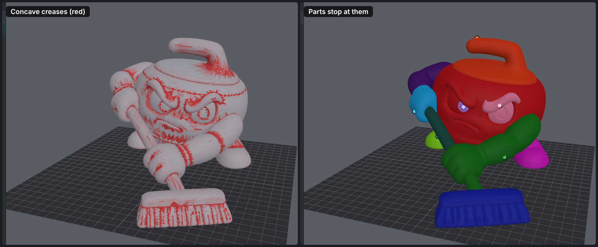
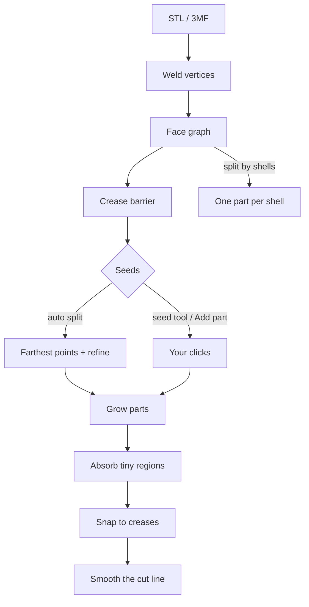
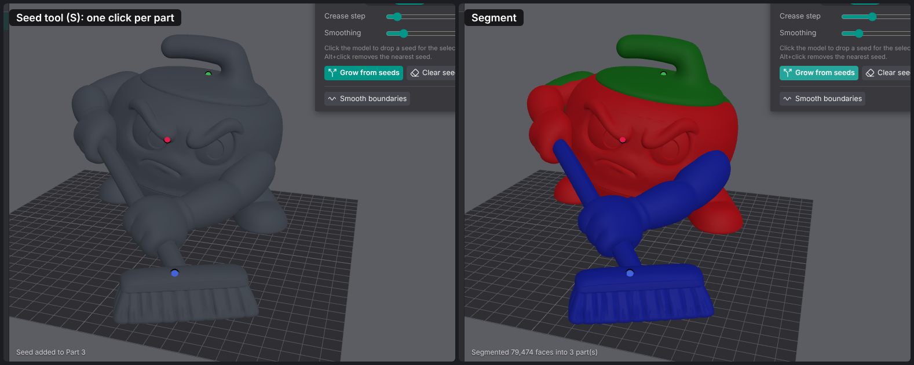
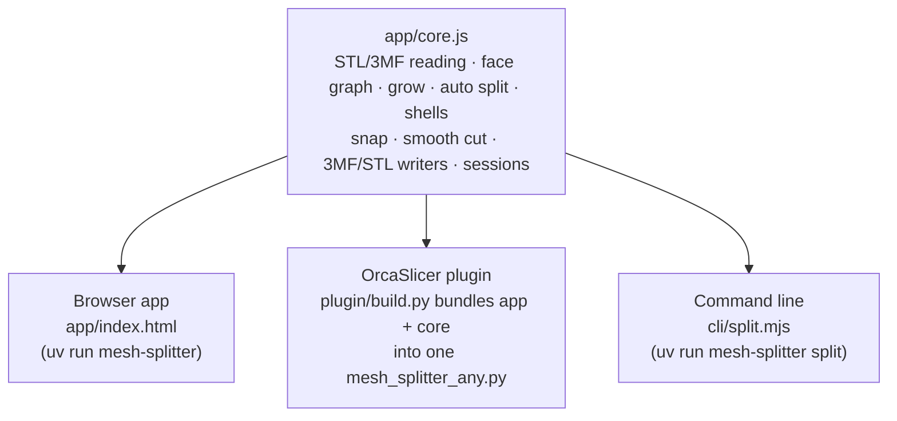
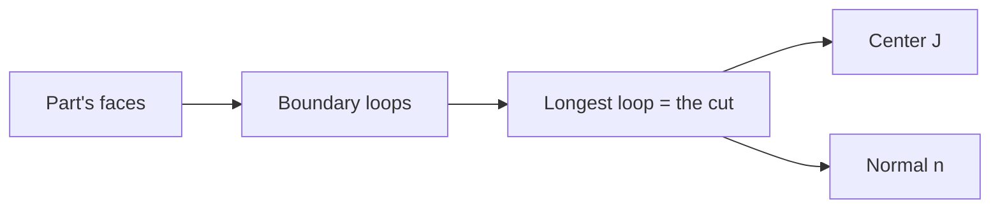
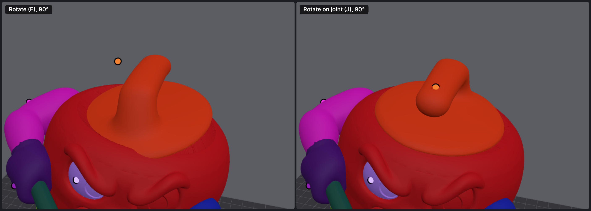
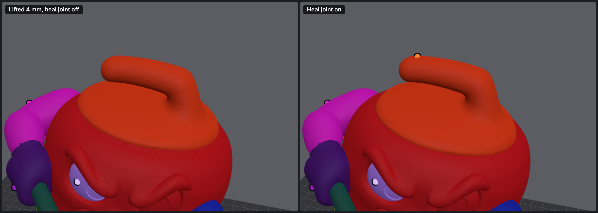
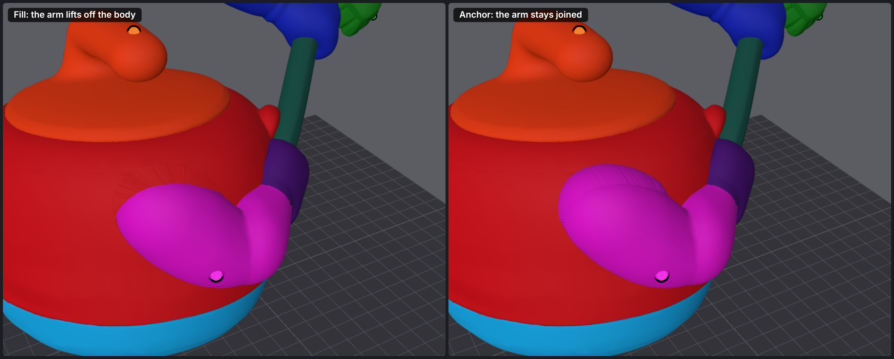
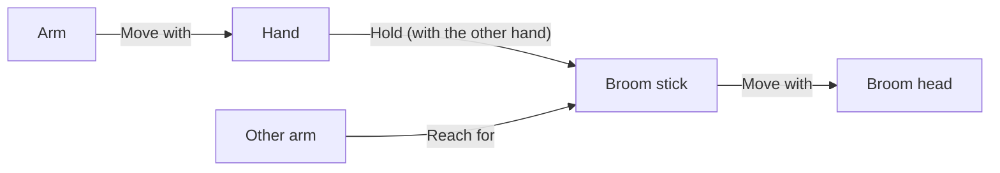

# How it works

What happens between opening a mesh and getting a multi-part 3MF back: how the splitter decides where parts end, how the same code runs in the browser, in OrcaSlicer and on the command line, and the math behind moving parts that are joined to each other.

- [The splitting pipeline](#the-splitting-pipeline)
- [One core, three front ends](#one-core-three-front-ends)
- [Moving joined parts](#moving-joined-parts)
- [Exports](#exports)

## The splitting pipeline

Parts are separated where the surface folds inward. A valley where an arm meets a body is a concave crease, and that's where people see one part end and the next begin (the "minima rule" from perception research). Ridges and smooth surfaces are kept inside a part.

### 1. Face graph

The mesh is read as triangles, and duplicate vertices are welded so neighboring faces share edges. Each face becomes a node, and each shared edge links two faces. For every link it stores:

- **Distance:** centroid to edge midpoint to centroid, the cost of walking across the surface.
- **Dihedral angle:** how sharply the surface bends at that edge.
- **Concave or convex:** whether the normals turn toward each other (a valley) or away (a ridge). A convex bend counts only 15% as much as a concave one.

The graph also gives the shell count: faces that can't reach each other are separate shells.

### 2. Crease barrier

Each face gets a concavity score: the average signed bend of its edges. That score is smoothed over neighboring faces a few times (the **Denoise** setting), so a single noisy triangle doesn't look like a crease but a real fillet or groove still does. Each edge's barrier is the larger concavity of its two faces, in degrees. The red in the picture above is this barrier.

### 3. Growing parts from seeds

Every seed (a face that belongs to a part) grows outward over the face graph at the same time, using a priority queue. The rule for which part gets a face:

1. **Lowest worst crease:** each face goes to the seed it can reach while crossing the gentlest worst crease along the way. Barriers are rounded down to steps of the **Crease** setting, so bends smaller than one step are free.
2. **Then shortest path:** ties go to the seed that is closer over the surface.

Because of rule 1, a large part keeps its whole smooth surface and stops at the valleys around it, instead of losing its far side to a small part that happens to be nearby.

### 4. Auto split

Auto split places the seeds itself:

1. **Spread out:** the first seed goes to the face farthest from an arbitrary start. Each new seed goes to the face farthest from all existing seeds (farthest-point sampling).
2. **Settle:** the parts are grown, then each seed moves to the deepest face of its part (the one farthest from the part's edge), and the parts are grown again. This repeats up to 8 times, until the seeds stop moving.
3. **Automatic count:** with no part count given, it over-splits (16 to 32 seeds), then repeatedly merges the two neighboring parts whose shared edge is the least creased, until every remaining edge runs along a real crease (an average barrier of at least 6°).

**Selected only** runs the same steps inside one part.

### 5. Split by shells

No creases involved: each disconnected shell becomes a part, largest first, named `Shell 1`, `Shell 2`, …

### 6. Cleanup

- **Absorb tiny regions:** parts smaller than about 0.3% of the faces (pits, noise) are regrown from their neighbors.
- **Snap to creases:** growing can leave a flap of one part lying on its neighbor's smooth surface, short of the crease where they actually meet. Near every boundary, faces are relabeled with a minimum cut (max-flow) where cutting along a concave crease is almost free and cutting across a smooth surface costs its length. The boundary slides onto the crease.
- **Smooth the cut line:** part labels are per face, so a boundary is a zigzag of triangle edges. Each vertex near a boundary gets a weight per part, the weights are blurred along the surface, and the boundary is redrawn where the two strongest parts tie. Faces the new line crosses are split along it. The mesh gains vertices and faces, but the surface shape doesn't change.

## One core, three front ends

The parsing, the splitting pipeline and the file writers live in one JavaScript module, `app/core.js` (added in [#29](https://github.com/d-carrigg/mesh-splitter/pull/29)). It has no UI, no three.js and no DOM, so all three front ends import the same file. The same mesh and settings give the same parts in each.

- **Browser app:** `app/index.html` imports `core.js` and adds the 3D view, the tools, transforms and the UI.
- **OrcaSlicer plugin:** `plugin/build.py` bundles the page, `core.js`, three.js and fflate into one page, compressed into the plugin's Python file. Inside OrcaSlicer the page talks to the plugin over `window.orca` messages: the plugin sends the plate's mesh in, and the page sends the finished 3MF out to be saved.
- **Command line:** `cli/split.mjs` runs on Node.js and calls the same functions. A saved session from the app can be loaded there, and the reverse. See [Command line](features/command-line.md).

## Moving joined parts

Every part can carry its own transform: scale, rotation and move, applied about the part's center. Part transforms change the view and every export except the painted 3MF, which is one mesh. The features below all build on that.

### Joint frame

Several features need a part's **joint**: where it was cut from its neighbor. The joint is the part's longest open boundary loop. From it:

- **J:** the loop's center.
- **n:** its normal (the loop's orientation), pointing out of the part.

A part without a cut (a whole shell) has no joint.

### Rotate on joint

[Rotate on joint](features/transforms.md#rotate-on-joint) ([#23](https://github.com/d-carrigg/mesh-splitter/pull/23)) shows one ring whose axis is **n**, centered on **J**. While you drag, only the twist about **n** is kept, and the part is rotated about **J** instead of its own center. Because the cut spins in its own plane around its own center, it stays on the neighbor's surface.

### Heal joint

A moved part's cut no longer lines up with its neighbor's edge. [Heal joint](features/transforms.md#heal-joint) ([#24](https://github.com/d-carrigg/mesh-splitter/pull/24)) bends the part near the cut to close the gap:

1. The cut loop at its original place is the **rim** the part must meet. Each rim point is indexed by its angle around **J**.
2. After the transform, each loop vertex is matched to the rim point at the same angle, which gives a pull vector.
3. Every vertex of the part takes the pull of its nearest loop vertex, faded by a cosine falloff over the blend distance (20% of the cut's radius by default, 1 to 15 mm). At the cut the pull is 100%. Past the blend distance it's 0, and the shape is exact.

The healed shape is computed on the fly from the transform, so changing the move or rotation re-heals it. Exports use the healed shape.

### Fill and anchor

When a part moves, the cut loop it shares with a neighbor opens if the loop's vertices no longer land on the same place for both parts. [Fill and anchor](features/transforms.md#fill-and-anchor) close each open loop in one of two ways:

1. **Fill** builds rings that shrink from the loop to its center. On the bigger side, the rings are lifted onto a quadratic surface fitted (least squares) to that part's vertices around the hole, so its curve continues across it. The smaller side uses a plane fitted to the loop.
2. **Anchor** sweeps the loop from the neighbor's rim (where it was) to the part's moved cut. The turn between them is split into steps (about 8° each) and each ring is the rim turned part of the way, so the new material follows an arc, like a bent joint.

Each part's export is then its faces plus these patches, a closed solid.

### Move with, Reach and Hold

These link parts so that moving one updates others ([#31](https://github.com/d-carrigg/mesh-splitter/pull/31)). Each is stored on the following part and refreshed whenever its leader changes.

- **Move with:** the follower keeps a fixed offset to its leader: its matrix = leader's matrix × the offset saved when you linked them. Moving the leader carries the follower, and its followers in turn. Moving the follower itself just updates the offset. Loops are refused.
- **Reach:** for an arm reaching a broom. The part has a **pivot** (its joint with the rest, the shoulder) and an **end** (where it touches the target, the hand on the stick). When the target moves, the part rotates about the pivot so the end points at the target's new position, and it stretches along that line by new length ÷ old length, so the end lands on it.
- **Hold:** a part held by two others (a stick in two hands). Its two grip points are where it touches each holder. When the holders move, the grip-to-grip line is turned onto the new grip-to-grip line by the shortest rotation and centered between the new grips. It also stretches along that line so both grips land exactly ([#32](https://github.com/d-carrigg/mesh-splitter/pull/32)), and parts that move with it (the broom head) ride along without the stretch.

Links follow parts by an id, not their position in the list, so they survive merges and deletes.

## Exports

- **Multi-part 3MF / Send to Orca:** one object whose components are the parts. `Metadata/model_settings.config` gives each one `subtype="normal_part"`, its name and its extruder, so OrcaSlicer and Bambu Studio open them as parts with their filaments set.
- **Painted 3MF:** the original mesh, with each triangle tagged with its part's filament (the same encoding as Orca's color painting).
- **Part STLs:** each part closed into a solid: its cut faces are capped.
- **Merged STL:** all parts in one STL, with moved, healed and replaced parts where you put them.
