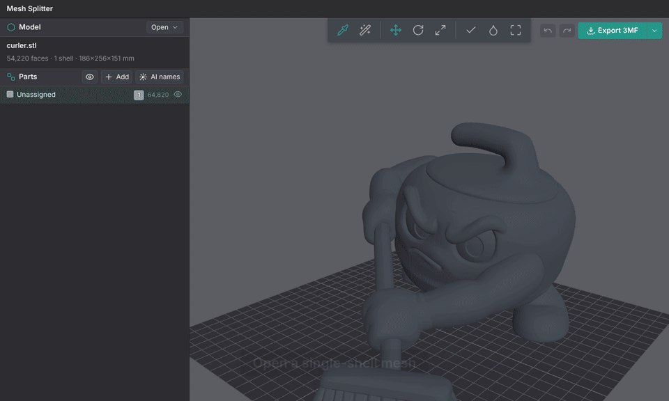

# Mesh Splitter

Split one solid mesh into separate, color-coded parts for multi-color or multi-piece printing, right inside OrcaSlicer. You can also scale, rotate, transform, or replace subsections of a mesh. For the example photo, I made the eyes 1 part, then replaced them with a flipped version to change where the figure looked. It also runs in **any browser**.



## Guides

- **[Splitting](features/splitting.md):** auto split, split by shells, seeds and Add part
- **[Editing parts](features/editing-parts.md):** fill, brush, merge, Replace with…, show only, rename, AI part naming
- **[Move, rotate, scale and heal](features/transforms.md):** handles, snapping, undo, rotate on joint, heal joint
- **[Exporting](features/exporting.md):** Send to Orca, painted 3MF, part STLs, merged STL

## Install in OrcaSlicer

1. Download `mesh_splitter_any.py` from the [latest release](https://github.com/d-carrigg/mesh-splitter/releases/latest).
2. In OrcaSlicer 2.5, open **Plugins**, click the arrow next to **Browse plugins**, then **Install local plugin** and pick the file.
3. Tick **Activate** and allow writing to Downloads. A **Mesh Splitter** tab appears next to Prepare / Preview.

The tab lists the objects on your plate, and a single object opens automatically. **Send to Orca** saves `<name>_parts.3mf` to Downloads. Import it with **Ctrl+I**, because Orca's plugin API can't add objects to the plate itself.

## Run in a browser

Install [uv](https://docs.astral.sh/uv/getting-started/installation/), then run:

```
uv run mesh-splitter
```

It opens at `http://127.0.0.1:8766/app/`. Everything runs locally, and nothing is uploaded.

## Controls

| Key | Action |
| --- | --- |
| W / E / R / Q | Move / rotate / scale handles, then hide them |
| J | Rotate on joint: one ring about the part's cut axis, pivoting at the cut's center |
| Shift (while dragging) | Snap to 1 mm, 15° or 5% |
| C | Toggle part colors / filament colors |
| Home | Frame the model |
| Del | Delete the part (its faces join the neighbor) |
| Ctrl+Z / Ctrl+Y | Undo / redo |
| Right-click | Part actions: rename, show only, replace, … |

## Credits

Source, issues and releases: [github.com/d-carrigg/mesh-splitter](https://github.com/d-carrigg/mesh-splitter). MIT license.

The figure in these docs is a model created with [Meshy](https://www.meshy.ai/) under the [CC BY 4.0 License](https://creativecommons.org/licenses/by/4.0/). The model is not included in the repo.
