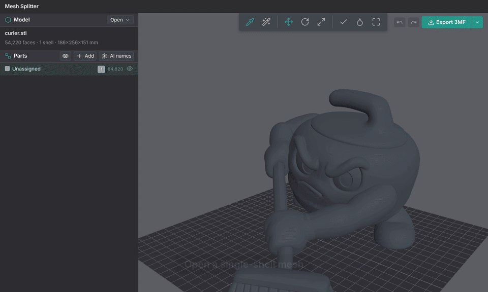
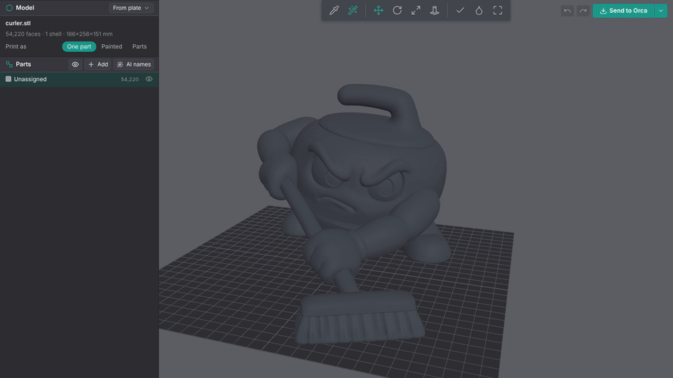

Split one solid mesh into separate, color-coded parts to edit it, color it, or print it in several filaments, right inside OrcaSlicer. Scale, rotate, or completely replace sections of the mesh for easy customization of single or multi-material prints. If you have ever been asked to print a part and customize "just this one thing," you may like this plugin.

**Docs:** [Splitting](https://d-carrigg.github.io/mesh-splitter/features/splitting/) · [Editing parts](https://d-carrigg.github.io/mesh-splitter/features/editing-parts/) · [Move, rotate, scale and heal](https://d-carrigg.github.io/mesh-splitter/features/transforms/) · [Exporting](https://d-carrigg.github.io/mesh-splitter/features/exporting/) · [How it works](https://d-carrigg.github.io/mesh-splitter/how-it-works/)

For the example photo, I made the eyes 1 part, then replaced them with a flipped version to change where the figure looked. See more in the [Examples](https://d-carrigg.github.io/mesh-splitter/examples/).

## Features

- **Split in a few clicks:** auto split, split by shells, or click a seed per part. Cuts follow the model's creases.
- **Move, rotate, scale:** move, rotate, and scale both within the context of the world axes and of the part orientation. This means you can do things like rotate limbs and increase specific part sizes.
- **Multicolor / multi-material printing:** individual parts can be given their own materials and colors pulled from your printer.
- **Replace with…:** right-click a part and swap in another STL. It snaps onto the joint and keeps the part's name and filament.
- **Connectors:** the Connectors tool puts a peg and matching hole (or a separate dowel) where parts touch, on every part or the ones you select, like the connectors in OrcaSlicer's Cut tool. Click a part to change its connectors.
- **Send to Orca:** the edited model goes back on the plate: next to the original, in its place, or filling the plate. **Print as** picks one part on the original's filament, one painted part, or separate parts on their own filaments. Painted 3MF, merged STL and per-part STLs are also available.

## How to use

1. Subscribe, then tick **Activate** and allow writing to Downloads. A **Mesh Splitter** tab appears next to Prepare / Preview.
2. The tab lists the objects on your plate. A single object opens automatically.
3. Split the mesh, then click **Send to Orca**. When OrcaSlicer asks, pick **Open as project**.

**The only official release is by @dcarrigg, here on OrcaCloud and on [GitHub](https://github.com/d-carrigg/mesh-splitter/releases).** Copies listed under other names are not made or checked by me.

Source (MIT): [github.com/d-carrigg/mesh-splitter](https://github.com/d-carrigg/mesh-splitter)

Screenshot model created with [Meshy](https://www.meshy.ai/), [CC BY 4.0](https://creativecommons.org/licenses/by/4.0/).
